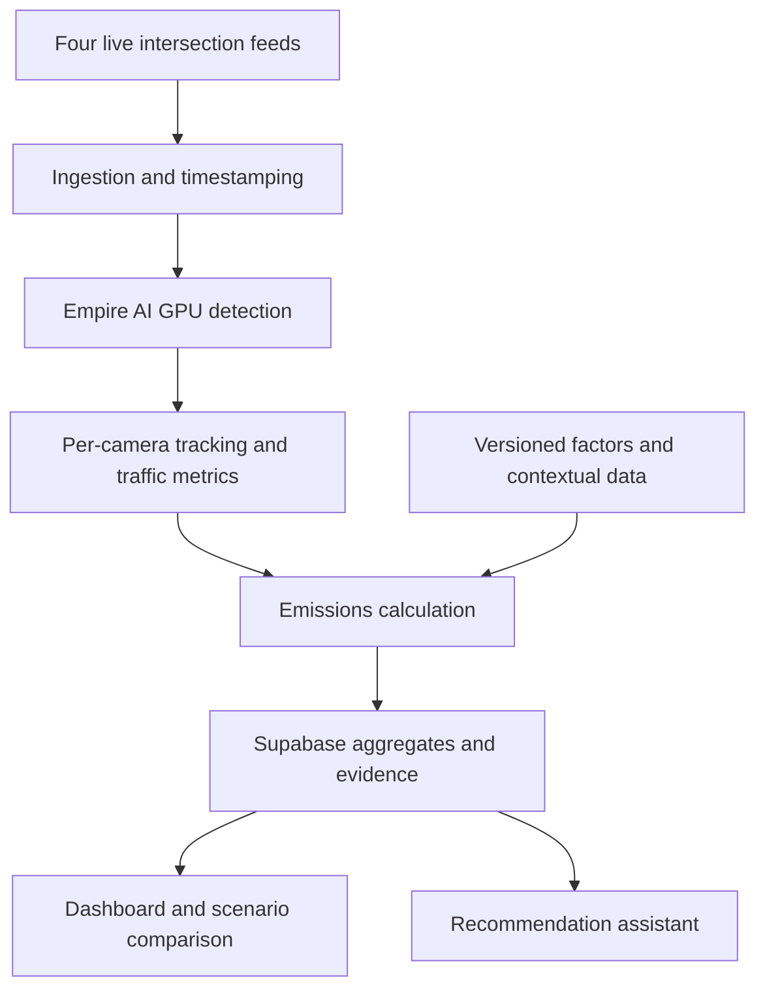

# Emission Lens — Hackathon Master Plan

**Team:** Mert and Carter  
**Event:** NYCAIRR × HackBU 2026, Binghamton University  
**Track:** Environment  
**Document version:** 1.0 — 7 November 2026  
**Submission deadline:** 8 November 2026, 11:00 America/New_York  
**Status:** Four-camera GPU tracking, authenticated local status/preview delivery, durable local ingestion, the dashboard and scoped CARB factors are demonstrated. Configured crossing observations, valid road calibration, approved class mappings, calibrated traversals, held-out accuracy and hosted shared persistence remain open.

---

## 1. Project definition

**Emission Lens uses live public intersection cameras to observe traffic, estimate traffic-related emissions, and help planners identify where further investigation or interventions could be useful.**

The system combines GPU-powered vehicle detection, tracking, calibrated traffic measurements, regional emissions factors, and contextual data. Users can inspect the evidence behind an estimate and explore explicitly hypothetical changes, such as shorter queues or a different fleet composition.

**Pitch:** “Existing cameras show us traffic. Emission Lens helps us understand its environmental footprint and explore what could improve it.”

The goal is a complete, credible environmental application with substantial engineering depth and an understandable live demonstration.

## 2. Confirmed decisions

| Topic | Decision |
|---|---|
| Name | **Emission Lens** |
| Primary setting | Signalized intersections in Torrance, California |
| Initial camera count | Four |
| Camera IDs | 222, 223, 228, 220 |
| Primary observed behavior | Vehicle flow, queues, stopped time, and traversal time |
| Primary pollutants | Estimated tailpipe CO₂ and NOₓ |
| Compute | Use Empire AI GPUs meaningfully for vision processing |
| Core product | Live monitoring, evidence inspection, and intervention scenarios |
| Scientific framing | Modeled emissions estimates; not measured air quality |
| Coordination | Mert coordinates project decisions and implementation agents |
| External communication | Drafts and exports only; no automatic messages or government contact |

The four-camera intersection scope supersedes the earlier three-camera plan and suggestions to expand onto freeways.

## 3. Verified camera inputs

These four streams were checked on **7 November 2026 at approximately 13:31 America/New_York**. Verification included downloading video segments, decoding frames, inspecting the views, and confirming advancing stream sequences.

All four delivered **1280 × 720 H.264 video** during that check. Availability and camera orientation can change.

| ID | Location | Latitude | Longitude | HLS URL |
|---|---|---:|---:|---|
| 222 | SR-107 at Carson Boulevard | 33.831350 | -118.352860 | https://wzmedia.dot.ca.gov/D7/CCTV-222.stream/playlist.m3u8 |
| 223 | SR-107 at Torrance Boulevard | 33.837770 | -118.353910 | https://wzmedia.dot.ca.gov/D7/CCTV-223.stream/playlist.m3u8 |
| 228 | SR-107 at 182nd Street | 33.865469 | -118.352406 | https://wzmedia.dot.ca.gov/D7/CCTV-228.stream/playlist.m3u8 |
| 220 | SR-1 at Crenshaw Boulevard | 33.792140 | -118.333500 | https://wzmedia.dot.ca.gov/D7/CCTV-220.stream/playlist.m3u8 |

Use these stable master playlist URLs. Resolve child playlists and segment URLs dynamically; do not hardcode temporary media URLs.

**Metadata:** https://cwwp2.dot.ca.gov/data/d7/cctv/cctvStatusD07.json

The three SR-107 cameras form the closest corridor. Camera 220 adds another nearby intersection with a different view and traffic pattern.

## 4. Scope and priorities

### Required

- Four configured intersection feeds, with one working end to end first.
- Actual Empire AI GPU execution, with recorded evidence.
- Vehicle detection and per-camera tracking.
- Queue counts and stopped-time measurements.
- Calibration-dependent movement and traversal estimates.
- Documented emissions calculations using traceable factors.
- Live map, camera detail view, and historical timeline.
- Data freshness, uncertainty, and failure states.
- A useful scenario comparison.
- An evidence-backed recommendation brief.
- Clearly labeled replay for demonstration continuity.

### Secondary

- Current weather context.
- Nearby school or other sensitive-site locations.
- Review queue for uncertain observations.
- Detector benchmarking and model comparison.
- Editable scenario assumptions.

### Stretch

- Fine-tuning on camera-specific examples.
- Validated EV identification.
- Exhaust and non-exhaust PM estimates.
- CalEnviroScreen and Census context.
- More cameras.

Training, Tesla recognition, and additional data layers must not delay the complete core pipeline.

## 5. Architecture



### Proposed stack

| Component | Default |
|---|---|
| Ingestion and worker | Python, FFmpeg/OpenCV |
| Detection | Pretrained Ultralytics YOLO |
| Tracking | ByteTrack |
| GPU runtime | PyTorch/CUDA on Empire AI |
| Persistence | Supabase/PostgreSQL |
| Web application | Next.js and TypeScript |
| Map | MapLibre or an equivalent supported library |
| Hosting | Vercel for frontend and short API requests |
| Recommendation assistant | Tool-based access to validated aggregates |

Pin dependencies and model weights after checking compatibility on the actual compute node.

Long-running video processing runs in a worker, separate from web request handlers.

## 6. GPU deployment

**Verification update (7 November 2026, 18:30 America/New_York / 23:30 UTC):** Job `175627` ran all four independent YOLO11n/ByteTrack pipelines on CUDA for a 120-second benchmark (2,655 processed frames, 82 reader-buffer drops on two cameras) and a separate 90-second delivery check (18 persisted batches, 47 temporary previews, no pending uploads). The dashboard decoded a matching frame/overlay, showed advancing processing status, and changed all cameras to offline at worker shutdown. A paced local replay also delivered only to replay mode. See the diagnostic records and limitations in `evaluation/README.md`. This verifies bounded processing/delivery, not calibrated traffic, accuracy, capture latency or six-hour reliability.

The hacker guide specifies:

- Partition: `alpha`
- Reservation: `binghamton_hackathon`
- GPU resource: `gpu:1g.10gb:1`
- Maximum two slices per person.
- Maximum six hours per job.
- Example system memory allocation: 32 GB.
- Individual accounts and two-factor authentication.

GPU slices have separate memory allocations; two slices do not automatically become one shared 20 GB device.

### Deployment sequence

1. Complete account setup privately.
2. Verify the allocated device and CUDA availability.
3. Run detection on one short camera clip.
4. Measure throughput and GPU memory use.
5. Test continuous input and delivery of results.
6. Expand to four cameras.
7. Save state and restart cleanly across job boundaries.

**Primary plan:** GPU worker performs live detection. Use direct stream access if permitted and functional.

**Fallback transport:** Laptop ingests streams and relays timestamped compressed batches to the allocated worker using an available authenticated connection.

Direct Caltrans access, the installed detector environment, and one-camera GPU inference were verified on a compute node. Sustained processing, relay bandwidth, installed modules beyond this environment, and inbound networking remain unverified. Do not assume a public GPU HTTP endpoint is available.

**GPU verification note (7 November 2026, 15:55 America/New_York / 20:55 UTC):** Mert runs GPU work on his account. Job `175330` on `alphagpu01` processed 50 advancing live frames from camera 222 with pretrained YOLO11n on an H100 MIG `1g.10gb` device. The verified allocation uses account `rpicourse` and QOS `normal`; an explicit account is required. All 39 Python tests passed there after integrating Carter’s detector and dataset tools. See `evaluation/README.md` and `evaluation/empire-ai-175330.json`. This is a smoke test, with 27 bounded-buffer drops; it does not establish sustained throughput, accuracy, or dashboard delivery. Fine-tuning awaits labeled images and held-out evaluation. Custom-class contract changes remain a separate proposal before implementation.

If live remote processing is blocked, retain a working local pipeline and use Empire AI for genuine benchmark or training work. Disclose the actual architecture.

### Batch template

```bash
#!/bin/bash
#SBATCH -p alpha
#SBATCH --account=rpicourse
#SBATCH --qos=normal
#SBATCH --reservation=binghamton_hackathon
#SBATCH --gres=gpu:1g.10gb:1
#SBATCH -c 1
#SBATCH --mem=32G
#SBATCH -t 04:00:00
#SBATCH -J emission-lens
#SBATCH -o %x-%j.out

# Load the verified environment here.
nvidia-smi -L
python -m worker.main
```

The Python entry point above is implemented; `infra/worker.slurm` supplies the bounded runnable job. The account and QOS above are Mert’s verified hackathon settings; other accounts must check their own associations. The runnable GPU smoke-test command is documented in `evaluation/README.md`.

Never put passwords, scratch codes, tokens, or personal credentials in this document, source control, logs, or shared prompts.

## 7. Vision pipeline

### Ingestion

- Maintain independent state per camera.
- Decode HLS and preserve source timing where available.
- Distinguish capture time, receipt time, and processing time.
- Start with a target of approximately five inference frames per second per camera; benchmark before promising performance.
- Use bounded queues and discard stale frames when overloaded.
- Reconnect automatically with backoff.
- Detect stalled playlists.
- Record actual processed coverage.

Do not report a camera as live merely because its last frame remains visible.

### Detection

Start with pretrained classes:

- Car
- Truck
- Bus
- Motorcycle
- Unknown/uncertain

Sedan, SUV, pickup, box truck, and articulated truck are optional refinements requiring validation. Do not claim that a generic pretrained detector already distinguishes all these classes.

**Section note (7 November 2026, 16:22 America/New_York (21:22 UTC)):** Mert and Carter moved fine-tuning forward. Target classes are car, tesla, pickup, box_truck, tractor_trailer, bus, and motorcycle. A Tesla below 85% average confidence over at least three frames is reported as car. The pretrained model stays the fallback unless the tuned model wins on held-out frames. Contract 1.1 adds these classes and keeps `truck` and `unknown`.

### Tracking

- Maintain IDs within each camera session.
- Reset or namespace IDs after worker restarts.
- Count line crossings rather than detections per frame.
- Preserve separate state when batching multiple streams.
- Do not track identities between cameras.

### Calibration

For each camera, configure:

- Road region of interest.
- Entry and exit gates.
- Road-plane reference points.
- Measured distances.
- Calibration version and quality status.

Apply a homography only where its road-plane assumptions hold. Validate against independent landmarks. A speed limit is not sufficient calibration evidence.

When calibration is invalid, retain counts and appropriate image-based queue observations, but suppress unsupported speeds and distance-based emissions.

### Stopped time

Use a configurable movement threshold, smoothing, and minimum duration. An initial candidate is below approximately 0.5 m/s for at least three seconds, subject to validation.

Call the observation **stopped time**. Video generally cannot establish whether an engine is running.

Exclude parked vehicles and non-road regions where possible. Report incomplete tracks and occlusions.

## 8. Emissions methodology

**Scope note (7 November 2026, 16:16 America/New_York / 21:16 UTC):** Mert directed immediate implementation of CARB factor acquisition, validation, and the calculation interface. This expands Mert's current work into the factor-data portion of `emissions/`; Carter continues training, labeling, and vision work. No detector classes or contract 1.0 fields change in this work.

### Essential correction

The original formula was:

```text
moving distance × moving factor + idle time × idle factor
```

Do not apply that formula indiscriminately with EMFAC.

EMFAC running-exhaust factors already include ordinary driving-cycle idling, including intersection stops. Its separate idle process concerns extended heavy-duty-truck idling. Adding that process to every stopped car would double-count emissions.

### Initial implementation

Use completed, calibrated traversals:

```text
average speed = observed segment distance / total traversal time

estimated exhaust emissions =
observed segment distance × matching running-exhaust factor
```

Total traversal time includes stops.

This is a segment-level approximation using average-speed factors, not a second-by-second engine model.

Use broader reporting windows when too few complete traversals exist. For a queue with no completed traversals, report insufficient emissions evidence or a separately documented estimate; never silently substitute zero.

### Factor requirements

Every factor table must record:

- Source URL and model version.
- Retrieval or generation date.
- Region, calendar year, and applicable season.
- Vehicle category and fleet assumptions.
- Pollutant and emissions process.
- Speed bin and units.
- Meteorological assumptions.

Convert source units consistently to metres, kilometres, seconds, and grams.

**Factor status (7 November 2026, 16:25 America/New_York / 21:25 UTC):** Mert acquired and validated 1,296 CARB EMFAC2025 v2.1.1 RUNEX CO₂/NOₓ factors for Los Angeles (SC), 2026, Annual, across 12 EMFAC2007 categories, 18 speed bins, and 60/70/80 °F at 60% relative humidity. Original CSV, request settings, provenance, checksums, a reproducible importer, and a completed-traversal calculation interface are in `emissions/`. These temperatures are scenario assumptions. Live estimates remain unavailable pending valid calibration, documented visual-class mappings and completed traversals. No uncertainty range or EV adjustment is silently applied. See `emissions/README.md`.

### Vehicle categories and fuel

Visual appearance does not establish regulatory weight class, model year, fuel, or emissions standard.

Use documented mappings and regional fleet mixtures. Unknown vehicles stay unknown. An all-combustion case may be a labeled upper scenario, not the default asserted truth.

Tesla classification is optional. Any EV adjustment must avoid subtracting EVs twice from a fleet-average factor.

Keep the initial pollutant scope to tailpipe CO₂ and NOₓ. Add PM only with documented exhaust, brake, and tyre components.

### Reporting boundaries

- Estimates cover the configured observed segment and reporting period.
- Do not extrapolate across unobserved roads.
- Do not sum overlapping segment estimates without checking coverage.
- Partial minutes and missing footage remain explicit.
- Label outputs **estimated emissions**, never measured AQI or pollutant concentration.

## 9. Uncertainty

Vary documented assumptions for:

- Vehicle classification.
- Fleet composition and fuel.
- Calibration.
- Applicable factor selection.

Show lower, central, and upper scenario estimates. These are **scenario ranges**, not statistical confidence intervals unless independently justified.

Missing observations are not repaired by adding an arbitrary percentage. Report camera coverage separately.

Check whether hotspot rankings remain stable across assumptions. Unstable rankings should request more evidence.

## 10. External context

| Source | Intended use | Priority |
|---|---|---|
| CARB EMFAC | Emissions factors | Required |
| Open-Meteo | Temperature, humidity, wind context | Secondary |
| School/site locations | Nearby sensitive-site context | Secondary |
| CEC vehicle data | Possible fleet-mixture assumptions | Optional |
| CalEnviroScreen | Community context at its published geography | Stretch |
| Census | Population context | Stretch |
| AirNow/PurpleAir | Regional comparison, subject to access | Stretch |

Weather values require source timestamps. Open-Meteo current conditions are model estimates.

Population nearby is not a count of people exposed. A mapped footway is not measured pedestrian activity.

Wind arrows can provide context. Do not render a quantitative pollution plume without a validated dispersion model.

Regional air monitors cannot independently validate emissions attributed to one intersection.

## 11. Intervention simulator

The user selects a camera, reporting period, and explicit hypothetical change:

- Reduce stopped time by a chosen percentage.
- Change the assumed electric fleet share.

For the shorter-stop scenario:

1. Hold vehicle count, segment distance, and non-stopped travel time constant.
2. Reduce the observed stopped component.
3. Recalculate traversal speeds and estimates.
4. Compare baseline and scenario with identical factor assumptions.
5. Display uncertainty and applicable model limits.

This does not demonstrate that a particular signal adjustment would produce the change. It also omits possible network effects and displaced queues.

Display:

- Baseline and scenario.
- Absolute and percentage difference.
- Assumptions.
- Data coverage.
- Model limitations.
- Whether the conclusion is robust across scenarios.

## 12. Recommendation assistant

The assistant queries structured evidence, explains findings, and drafts a reviewable brief.

Numerical calculations and rankings happen in code.

### Suggested tools

- `get_camera_status`
- `get_traffic_window`
- `get_emissions_window`
- `get_context`
- `compare_scenario`
- `rank_investigation_priorities`
- `draft_brief`

### Supported recommendation examples

| Evidence | Appropriate recommendation |
|---|---|
| Repeated long queues | Investigate signal timing and queue causes |
| Elevated modeled emissions near a sensitive site | Prioritize monitoring and site review |
| Heavy-vehicle contribution | Investigate fleet composition and operating patterns |
| High uncertainty | Collect better data or inspect the camera configuration |
| No local monitoring | Consider a sensor-placement study |

Truck rerouting, vegetation changes, and enforcement require additional engineering context. Do not present them as automatic solutions.

Rank **investigation priorities**, not medical risk. Separate emissions quantities, queue metrics, contextual proximity, and uncertainty rather than multiplying incompatible units into an unexplained score.

The generated brief includes the camera, time window, evidence, assumptions, scenario results, limitations, and suggested next step.

It may be reviewed and exported. No automatic sending.

## 13. Dashboard

### Overview

- Four intersection markers and observed road regions.
- Live/degraded/offline status.
- Traffic counts and queues.
- Estimated emissions with ranges.
- Data coverage and update times.
- Switch between vehicle activity and modeled emissions.

### Camera detail

- Video with synchronized overlays.
- Counts, stopped timers, and queue metrics.
- Calibration and model status.
- Traffic and emissions timeline.
- Factor provenance.
- Uncertainty explanation.
- Scenario controls.

### Review

- Explain uncertain events.
- Correct classifications or flag calibration issues.
- Preserve the original observation and review history.
- Recalculate dependent results where supported.

Use accessible colours and readable units. Unobserved roads remain visually distinct.

A delayed detection overlay must not be drawn over unrelated current video.

## 14. Shared data contract

**Integration note (7 November 2026, 18:18 America/New_York / 23:18 UTC):** The additive worker transport carries version 1.1 records in authenticated, revisioned batches. Local single-host persistence and server read routes are implemented. Capture UTC remains null when unavailable; processing freshness uses advancing-frame heartbeats. A hosted database adapter and actual GPU-to-dashboard verification remain separate checks.

**Contract version:** `1.1`

Store timestamps in UTC; display local time explicitly.

### Core records

| Record | Required fields |
|---|---|
| `camera` | ID, name, coordinates, stream URL, road-region geometry, enabled flag |
| `camera_calibration` | Camera, version, gates, reference measurements, transform, validation status |
| `worker_run` | Run ID, model version, device, start/end, mode |
| `camera_status` | Camera, heartbeat, last source timestamp, processing delay, FPS, state |
| `traffic_minute` | Camera, minute, run, class, mode, counts, completed traversals, stopped vehicle-seconds, traversal time, distance, queue metrics, coverage |
| `emissions_minute` | Camera, minute, pollutant, estimate/range, factor version, method version, quality state |
| `context_snapshot` | Camera/region, source, retrieved time, applicable time, values |
| `scenario_result` | Input window, assumptions, baseline, scenario, uncertainty, versions |
| `review` | Evidence reference, issue, correction, status, timestamp |
| `brief` | Evidence references, generated text, model, review status |

### Rules

- Counts are unique crossings, not detector observations.
- Summed stopped vehicle-seconds may exceed 60 per minute.
- `null` means unavailable; zero means a supported zero.
- Queue count and queue length in metres are different fields.
- Separate `live`, `replay`, and `synthetic` modes.
- Use idempotent writes and explicit revision handling.
- Do not mix replay with live totals.
- Preserve provenance after review.
- Keep service credentials server-side.

Agree on schemas before parallel implementation. Typed contracts and migrations must match this document.

**Contract note (7 November 2026, 14:40 America/New_York / 19:40 UTC):** `traversal_time_s` is recorded on `traffic_minute` because average speed needs total traversal time, including stops. `mode` is stored on records that can be live, replay, or synthetic. Both are additive. Queue count is a camera-minute observation and must not be summed once per vehicle class.

## 15. Repository and agent work packages

**Scope note (7 November 2026, 18:12 America/New_York / 23:12 UTC):** Mert directed completion of all remaining work that can proceed independently, including worker orchestration, validated ingestion, persistence, evaluation, and integration. Carter's in-progress labeling and training data are preserved. Mert coordinates these integration changes. The additive worker transport uses the existing 1.1 records; no scientific calibration or live class mapping is assumed.

Suggested layout:

```text
PLAN.md
Agents.md
Worklog.md
contracts/
config/cameras/
worker/
emissions/
backend/
frontend/
infra/
tests/
evaluation/
```

| Work package | Ownership | Acceptance |
|---|---|---|
| Contracts/backend | Schema, migrations, APIs, access policies | Fixtures and real writes use the same validated contract |
| Vision | Ingestion, GPU detector, tracking, calibration, metrics | No frame-count inflation; reconnect and four-camera isolation work |
| Emissions | Factor table, mappings, units, uncertainty, scenarios | No ordinary-idle double-counting; calculations reproducible |
| Frontend | Map, details, timeline, simulator, review | Handles null, stale, replay, and degraded states |
| Assistant | Evidence queries, brief generation | Numbers trace to records; no invented claims or sending tools |
| Integration/evaluation | Complete flow, benchmarks, demo | Live GPU-to-dashboard path demonstrated and limitations recorded |

Carter’s original plan assigns him vision and emissions. Preserve that proposed ownership unless the team changes it. Mert coordinates data, product, dashboard, and implementation agents.

**Section note (7 November 2026, 14:40 America/New_York / 19:40 UTC):** Mert started `contracts/`, `backend/`, `frontend/`, and the draft brief. Carter’s `worker/` and `emissions/` paths were not changed.

Each coding agent must:

1. Read this document and current contracts.
2. Work within assigned files.
3. Identify dependencies and blockers early.
4. Propose contract changes before implementing incompatible ones.
5. Report what changed, verification performed, and remaining limitations.
6. Avoid broad rewrites of another work package.
7. On every turn, timestamp completed work in `Worklog.md` and in any markdown whose status or instructions changed. See `Agents.md`.
8. Name only Mert and Carter in repo files, commits, and teammate-facing text. Do not name the coding tool or model.
9. Commit and push at the end of every turn when nothing looks broken.

**Section note (7 November 2026, 14:28 America/New_York / 19:28 UTC):** items 7–9 record the team’s every-turn logging, attribution, and push rules. Operational detail lives in `Agents.md`.

Agent messages are proposals, not automatic changes to project scope.

## 16. Validation

Use short manually reviewed clips from each camera, including different traffic conditions where available.

Measure:

- Vehicle-count error.
- Broad-class accuracy.
- Stopped-time error.
- Traversal/calibration error.
- Tracking failures.
- Processing throughput and latency.
- GPU memory use.
- Reconnection behaviour.

Keep training and evaluation frames separate.

Verify calculation units, missing-data handling, emissions process selection, and scenario consistency. Present emissions results as modeled estimates even if vision accuracy is good.

Compare a simple vehicle-count ranking with the richer class-and-traffic model. Report observed differences only after measurement.

No accuracy, latency, savings, or environmental-impact claim is a completed result until tested.

## 17. Privacy and replay

Persistent production records should primarily contain aggregates and provenance.

- No plate recognition.
- No facial identification.
- No person tracking.
- Temporary vehicle IDs scoped to a camera session.
- No raw footage committed to the public repository.
- Minimize incidental personal information in displayed or retained evidence.

For demo continuity, permit temporary local clips from the public feeds. Keep their capture times and source attribution; remove them after their purpose ends. Prefer redacted footage for public demo materials.

Replay must be visibly labeled and pass through the same processing pipeline.

## 18. Build order and deadlines

All event times below use America/New_York.

| Milestone | Deliverable |
|---|---|
| First integration milestone | One camera → GPU inference → structured output → dashboard |
| Next | Working calibration, queue metrics, traceable factors |
| Next | All four cameras and robust status handling |
| Next | Emissions timeline and uncertainty |
| Next | Scenario comparison and evidence-backed brief |
| Before final morning | Manual evaluation, replay, reconnect checks |
| Sunday 09:00 | Feature freeze target |
| Sunday 10:00 | Submission and demo materials ready |
| Sunday 11:00 | Devpost deadline |
| Sunday 11:30–14:30 | Judging expo |

These are planned milestones, not assertions of progress.

Do not make a late fine-tuning run the critical path. Keep the working pretrained model unless a replacement demonstrably improves held-out results.

## 19. Failure handling

| Failure | Behaviour |
|---|---|
| Feed unavailable | Mark offline; retain dated history; allow labeled replay |
| Camera moves | Invalidate calibration and suppress movement-dependent estimates |
| GPU integration blocked | Continue local development; test authorized relay; disclose actual GPU usage |
| Throughput insufficient | Lower inference FPS or input size; measure accuracy effect |
| Factor table missing | Display traffic metrics; mark emissions unavailable |
| Uncertain fuel/class | Use documented fleet assumptions and ranges |
| No completed traversals | Report insufficient evidence rather than zero |
| Assistant unavailable | Deterministic findings and scenario results remain usable |
| Context unavailable | Omit that factor and disclose missing context |
| Training underperforms | Retain pretrained baseline |

Never silently replace real inputs with synthetic values.

## 20. Demo and submission

### Three-minute demonstration

1. Explain the environmental question.
2. Show live intersection processing and GPU execution.
3. Inspect a queue and its measured traffic behaviour.
4. Open the estimated emissions and uncertainty.
5. Run a shorter-stop scenario.
6. Show the evidence-backed investigation brief.
7. State what was measured, modeled, and left uncertain.

Use labeled replay if the live scene does not illustrate a useful event.

### Submission checklist

- [ ] Public source repository and development commits.
- [ ] Environment track selected.
- [ ] Complete Devpost submission before 11:00 Sunday.
- [ ] Accurate architecture and setup instructions.
- [ ] Honest AI-use disclosure.
- [ ] Actual GPU execution evidence.
- [ ] Working live demonstration and labeled backup.
- [ ] Measured evaluation results.
- [ ] Factor sources, licences, and model attribution.
- [ ] Both teammates can explain the system.

Do not claim deployment to NYSDOT or Binghamton. Describe that as a possible future adaptation requiring separate access and calibration.

## 21. Immediate unresolved items

1. Confirm visual-to-CARB class mappings; the scoped RUNEX factor table is acquired and validated (7 November 2026, 16:25 America/New_York / 21:25 UTC).
2. Extend the bounded four-camera GPU/delivery verification to long-duration operation and forced-failure recovery; the 120-second benchmark and local authenticated delivery are verified.
3. Loopback-only SSH forwarding is verified for local delivery; a hosted shared persistence adapter remains required for deployment.
4. Configure and validate each camera’s road region and gates.
5. Finalize schemas and service ownership.
6. Four-camera bounded performance is recorded; evaluate longer runs, dropped-frame effects and held-out tracking accuracy.
7. Select the minimum contextual layer that adds demonstrated value.

## 22. Sources

- Hacker guide: https://docs.google.com/document/d/1A_yN6PBLpxP6pi_jx6evy6E3juQ5Wx8r_EVnKHujdqU/edit
- Caltrans portal: https://dot.ca.gov/programs/traffic-operations/traveler-information/cwwp
- Camera metadata: https://cwwp2.dot.ca.gov/data/d7/cctv/cctvStatusD07.json
- CARB EMFAC: https://ww2.arb.ca.gov/our-work/programs/msei/on-road-emfac
- EMFAC project-level methodology: https://emfac.arb.ca.gov/emfac2025-usersguide/uchap/ch6.pl_mode.html
- EMFAC output documentation: https://emfac.arb.ca.gov/emfac2025-usersguide/uchap/ch7.output.html
- Tracking documentation: https://docs.ultralytics.com/modes/track/
- Weather documentation: https://open-meteo.com/en/docs
- California school data: https://www.cde.ca.gov/ds/si/ds/pubschls.asp
- Empire AI quick start: https://empireai.freshdesk.com/support/solutions/articles/157000377792

This document merges Carter’s original plan with Mert’s subsequent decisions. It defines the intended implementation; it does not certify that the application, model, GPU deployment, or environmental estimates have already been validated.
