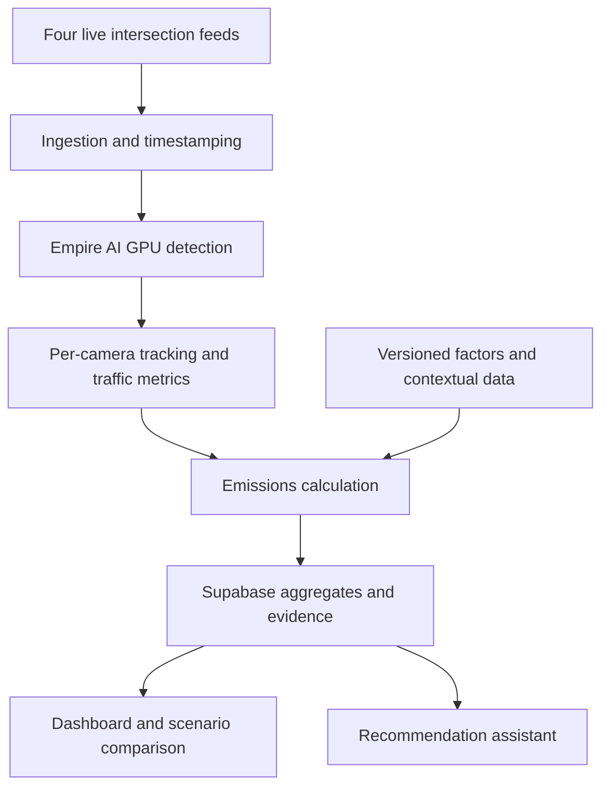

# Emission Lens — Hackathon Master Plan

**Team:** Mert and Carter  
**Event:** NYCAIRR × HackBU 2026, Binghamton University  
**Track:** Environment  
**Document version:** 1.0 — 7 November 2026  
**Submission deadline:** 8 November 2026, 11:00 America/New_York  
**Status:** The technical single-page application is deployed locally on3152 from exact web source4051e98. It adds a transparent scientific-input register, timestamped Open-Meteo context, durable local evidence annotations/audit history, explicit retained-minute selection and scoped planning/export to the accepted222/223 pipeline. Actual review create/state/reload/process-restart, exact draft download, interval-preserving navigation and source CI pass; all735/60 original records remain identical. Protected3151 continues to own live ingestion/previews and durable worker history. Cameras220/228 remain excluded from quantities; pretrained n/640 remains the accepted detector. Background HTTP delivery is implemented and controlled-benchmark tested, with a separately guarded continuation prepared for after the old176075.4 terminates/drains. No new GPU replacement is yet claimed. Shared hosting, field accuracy/sustained reliability and final human rehearsal/Devpost submission remain open.

**Implementation resumed (8 November 2026, 01:47 America/New_York / 06:47 UTC):** Mert explicitly supersedes the executive engineering freeze and authorizes three scoped implementation streams to finish the single-host application. The published source now supports independent 222/223 measurement configurations, conservative latest-minute image queues, visibly scoped supported-minute CO₂/NOₓ and explicit complete-minute shorter-stop comparisons. Core worker 1.1 and measurement 1.0 remain unchanged; additive read metadata and paired UTC minute boundaries are documented in the backend package. One combined frozen build is running separately at 3151 for acceptance, not yet a replacement of 3150. Carter's new 222/223 stopped-policy checklist is handled privately; Mert explicitly requests one bounded actual GPU replay exercise on already-reviewed practice video, 300 seconds wall limit per camera, unchanged pretrained settings, exact supplied stopped thresholds and independent fresh outboxes. Preserve healthy jobs 176075/176255 and protected 3138/3139/3150 services. No automatic model tuning, reserved footage, new 220/228 count approval or positive savings claim. Latest-generation authenticated 222 evidence and fresh-process reload now pass; this supersedes the earlier verifier-generation PARTIAL without erasing its original result. Browser/phone acceptance, actual two-camera stopped-policy replay, sustained operation, shared hosting and final submission remain separately open.

**Live recovery and parallel work (8 November 2026, 00:23 America/New_York / 05:23 UTC):** Mert verified the persistent SSH master and restored one production application on loopback port 3138, then independently checked advancing heartbeats, processed frames, changing preview bytes, increasing crossings and supported pollutant records from live GPU job 176075. The actual heat map displays these live records. The worker, application and scientific inputs remain pinned; [startup evidence](./evaluation/222-live-restart-176075.md) records the repaired relay guard and limits. Keep the authenticated Terminal and laptop/network available. The allocation ends before judging, so another bounded start or a verified labeled replay must be rehearsed before the final demonstration. Mert assigned isolated forced-outage/restart tests, exact 223 profile integration, blind practice review of the unchanged 228 count-1 gate and [submission preparation](./release/README.md) in parallel. No active 222 registry swap, new model promotion or fresh 228 evaluation is authorized by these assignments.

**Coordination and release decision (8 November 2026, 00:35 America/New_York / 05:35 UTC):** Mert confirmed the updated engineering roles in [Coordination.md](./Coordination.md), added a second frontend implementation/acceptance stream and requested small verified pushes throughout active work. The Assistant stream owns deduplicated Carter/project email checks every five minutes and source-based internal handoffs; external messages remain drafts only. Mert selected the AGPL-3.0 open-source route for the covered project code; licence/source/notices implementation is assigned, and remaining dependency/model/binary obligations must be recorded rather than presumed complete. Bounded isolated delivery recovery now has [job 176092 evidence](./evaluation/reliability/README.md); source outages, abrupt-loss offline policy and sustained operation remain distinct open checks. The newly frozen partial assisted 228 practice reference still fails both count bounds, so 228 remains unapproved and fresh footage remains reserved.

**220 priority release (8 November 2026, 00:40 America/New_York / 05:40 UTC):** Mert releases the available camera-220 recording/metadata for independent practice `[60,180)` review, geometry/policy freeze and then held-out `[360,480)` review in parallel with the unresolved 228 diagnosis. The earlier queue was a priority decision, not a technical dependency on fixing 228. Acquire the supplied source once, preserve native timing/provenance and freeze the assisted ledger before releasing model/human references. This does not authorize full-recording expansion, a production gate/approval change, new training or another GPU submission. The separately prepared 223 integration retains GPU priority; 228's reserved fresh interval remains unviewed. Carter retains 220 distance-calibration ownership.

**Four-recording execution release (8 November 2026, 00:45 America/New_York / 05:45 UTC):** Mert supersedes the earlier broad-recording deferral for one bounded offline pretrained baseline-count batch across the four available recordings, after the isolated 223 integration releases the spare GPU slice. Existing n/640/requested 15 FPS and original tracking/metric defaults remain frozen; no training, sweep, live-camera enablement or count acceptance is implied. Preserve original source event timestamps and independent camera/session state. Keep all 220 model/human answers private from its blind reviewer until the relevant ledger freeze. Omit reserved 228 `[720,840)` entirely and start a fresh tracking session after that gap; report the reservation, decoded gaps and initialization limits rather than continuous full coverage. The 223 integration uses the original-file timing adapter, because the derivative changed timestamps/sampling, on the independent frozen 3139 app and two-camera registry. Operational release is delegated to Mert's coordination stream, with a concrete-result checkpoint at **01:13 America/New_York / 06:13 UTC**. See [the four-recording status](./evaluation/four-recording-status.md). Scientific approvals and contract versions remain unchanged.

**Actual 223 integration and all-four execution (8 November 2026, 00:54 America/New_York / 05:54 UTC):** Isolated replay job 176174 completed 0:0 using the verified original-file adapter and frozen 3139 source/profile. Actual processed source time is **60.061–148.053 s** (1,319 frames), not all of `[60,180)`. It delivered 93 crossings and 26 completed candidates; the supported 05:49 UTC minute estimates **71.496669 g CO₂ / 0.014042455 g NOₓ** under the approved 15 m/fleet/70 °F/60% RH assumptions. Independent original-CSV contribution arithmetic, authenticated current evidence, fresh-process reload, exact preservation of 172 captured 222 worker batches/16 measurement entries, genuine advancing replay preview, heat map and brief export pass. The empty prior minute, whole-window totals and positive stopped-time scenario remain null. One preview delivery failed; drained queues and successful later previews are retained. [Browser evidence](./frontend/223-REPLAY-ACCEPTANCE.md) and [central status](./evaluation/four-recording-status.md) retain scope limits. The single all-four offline batch **176183** was submitted at **00:53:16 New York / 05:53:16 UTC**, with a 19-minute scheduler cap, 18-minute driver cap and absolute **01:12 New York / 06:12 UTC** stop. Its results/coverage remain pending. No production cutover or stopped-time candidate installation occurred.

**Completed recording batch and next live/stopped-policy test (8 November 2026, 01:07 America/New_York / 06:07 UTC):** Job 176183 completed **0:0 in 9m43s**, all seven requested intervals, no unattempted intervals/timebox partial. Unique four-recording baseline processing totals **66,903 sampled frames**; the overlapping two 220 review windows are separate (70,363 samples including them). Cameras 222/223/220 reached decoder EOF; 228 intentionally omits reserved `[720,840)` and restarts state at its suffix. Native 223 gaps and unreviewed footage prevent a continuous/full visual-coverage or accuracy claim. The 220 held-out ledger froze before reference access at **01:01:30 New York / 06:01:30 UTC**; only its two declared fresh-window model reports were released. The held-out model total 75 versus 106 partial assisted passages fails the provisional total-count screen; event-level reconciliation remains pending. 228 remains failed/unapproved.

Mert additionally requested genuine live camera connections and an actual E2E test of Carter's new observed-stopped-time policy. One isolated candidate at **3150**, separate from protected 3138 and accepted 3139, is CPU/parser/HTTP/linkage/RUNEX/scenario/reload-ready. The released next allocation uses one existing four-camera worker with only approved **222** geometry/traversal plus Carter's exact `+stop-v1` / `0.0225` policy; other cameras get genuine status/previews and unavailable new metrics. Actual video/stopped/scenario evidence is pending. Its two-hour worker / two-hour-six-minute allocation avoids the known 240-minute bridge cap; 10,000-event/32-clock and source/host limits remain real. No extra ordinary-idle process, engine-running inference, invented positive stop/scenario, new count approval or production swap. The 222 fit has only 12 in-movement stopped-reference intervals with 33.33% stopped recall; broader calibration-derived fitting scores do not establish field accuracy.

**Team consolidation (8 November 2026, 01:07 America/New_York / 06:07 UTC):** Mert requested one fewer engineer of each type. Front-End 1, Back-End 1 and Full-Stack 2 finish their current coherent milestone and hand off before retirement; root alone archives after completion. Front-End 2 retains browser/frontend, Back-End 2 retains GPU/worker/reliability, Full-Stack 1 retains integration/API/scenarios and video evidence, with both coordination streams retained. Existing work and acceptance limits transfer; no new tasks go to the retiring streams.

**Live activation and aligned count checkpoint (8 November 2026, 01:12 America/New_York / 06:12 UTC):** Candidate job **176255** is genuinely running since **01:08:15 New York / 06:08:15 UTC**, with all four cameras' advancing LIVE previews verified across repeated image/time/sequence reads and actual browser views on [the isolated local app](http://127.0.0.1:3150). Worker is bounded to two hours (roughly 03:08 New York, subject to actual worker start and failures); allocation ends **03:14:15 New York / 08:14:15 UTC**. Actual CUDA, fresh heartbeats and drained delivery queues are observed. Reader drops are real; this is not loss-free/sustained accuracy acceptance. Only 222 gets new approved movement/count inputs plus the exact stopped-policy candidate; other cameras get new live previews/status and unavailable new metrics. Current new 222 evidence contains linked stopped values `[0.066,0,0]` s then `[0,0]` s. This tiny observed positive/zero evidence is not engine-running identification, field accuracy or demonstrated benefit. Final same-cohort factor/20% scenario/reload audit remains in progress; retained legacy null-stop rows keep the whole-window scenario unavailable. Old 3138 and accepted 3139 stay intact.

The 220 aligned comparison is completed and published in `a70d2f3`: held-out **74 TP / 1 FP / 32 FN**, **69.81% agreement recall / 98.67% precision**, **−29.25% total difference**; practice recall **78.38% inclusive / 82.80% excluding endpoint ambiguity**. Both fail the provisional recall screen, so no 220 enablement follows. These are sampled partial assisted references, not human accuracy. [Video evidence handoff](./evaluation/video_validation/HANDOFF.md) transfers the frozen reviews and remaining blind boundaries to the retained integration stream. Front-End 1 and Back-End 1 are archived after completed handoffs; Full-Stack 2 is also confirmed archived after its completed publication and successor handoff.

**Dated checkpoint (7 November 2026, 23:02 America/New_York / 8 November 2026, 04:02 UTC):** GPU job 175979 completed 0:0 in 2m55s: 90-second replay retained 30 crossings / 8 completed traversals, followed by 60-second live delivery with 17 crossings / 4 completed traversals. Mert independently read both modes' persisted supported-minute estimates. Each reporting window also contains an insufficient-evidence minute, so its whole-window baseline remains null. A fresh-process reload, private-contribution arithmetic, actual-record brief/export and subsequent dashboard checks pass. Live recorded 265 buffer drops; this is an assumption-based delivery demonstration, not surveyed physical accuracy or continuous performance. The worker has stopped. See [coordination](./Coordination.md).

**Heat map and owner handoff (7 November 2026, 23:31 America/New_York / 8 November 2026, 04:31 UTC):** The overview's emissions heat layer is mounted to the same authoritative local store as camera-222 ingestion, with no worker credential in the consumer. Browser checks verify the 17.3 g live and 35.7 g replay supported-minute labels, separate modes, Traffic visibility, unavailable cameras and offline status. It is a camera-point visualization, not a dispersion/exposure model. Carter's `4c5a5ea` enables camera 223 using the explicitly assisted reference and records its 15 m southbound movement; human-reference metrics remain unavailable. See [heat-map behavior](./frontend/HEATMAP.md).

---

## 1. Project definition

**Emission Lens uses live public intersection cameras to observe traffic, estimate traffic-related emissions, and help planners identify where further investigation or interventions could be useful.**

The system combines GPU-powered vehicle detection, tracking, calibrated traffic measurements, regional emissions factors, and contextual data. Users can inspect the evidence behind an estimate and explore explicitly hypothetical changes, such as shorter queues or a different fleet composition.

**Pitch:** “Existing cameras show us traffic. Emission Lens helps us understand its environmental footprint and explore what could improve it.”

The goal is a complete, credible environmental application with substantial engineering depth and an understandable live demonstration.

## 2. Confirmed decisions

| Topic | Decision |
|---|---|
| Name | **Emission Lens** |
| Primary setting | Signalized intersections in Torrance, California |
| Initial camera count | Four |
| Camera IDs | 222, 223, 228, 220 |
| Primary observed behavior | Vehicle flow, queues, stopped time, and traversal time |
| Primary pollutants | Estimated tailpipe CO₂ and NOₓ |
| Compute | Use Empire AI GPUs meaningfully for vision processing |
| Core product | Live monitoring, evidence inspection, and intervention scenarios |
| Scientific framing | Modeled emissions estimates; not measured air quality |
| Coordination | Mert coordinates project decisions and implementation agents |
| External communication | Drafts and exports only; no automatic messages or government contact |

The four-camera intersection scope supersedes the earlier three-camera plan and suggestions to expand onto freeways.

## 3. Verified camera inputs

These four streams were checked on **7 November 2026 at approximately 13:31 America/New_York**. Verification included downloading video segments, decoding frames, inspecting the views, and confirming advancing stream sequences.

All four delivered **1280 × 720 H.264 video** during that check. Availability and camera orientation can change.

| ID | Location | Latitude | Longitude | HLS URL |
|---|---|---:|---:|---|
| 222 | SR-107 at Carson Boulevard | 33.831350 | -118.352860 | https://wzmedia.dot.ca.gov/D7/CCTV-222.stream/playlist.m3u8 |
| 223 | SR-107 at Torrance Boulevard | 33.837770 | -118.353910 | https://wzmedia.dot.ca.gov/D7/CCTV-223.stream/playlist.m3u8 |
| 228 | SR-107 at 182nd Street | 33.865469 | -118.352406 | https://wzmedia.dot.ca.gov/D7/CCTV-228.stream/playlist.m3u8 |
| 220 | SR-1 at Crenshaw Boulevard | 33.792140 | -118.333500 | https://wzmedia.dot.ca.gov/D7/CCTV-220.stream/playlist.m3u8 |

Use these stable master playlist URLs. Resolve child playlists and segment URLs dynamically; do not hardcode temporary media URLs.

**Metadata:** https://cwwp2.dot.ca.gov/data/d7/cctv/cctvStatusD07.json

The three SR-107 cameras form the closest corridor. Camera 220 adds another nearby intersection with a different view and traffic pattern.

## 4. Scope and priorities

### Required

- Four configured intersection feeds, with one working end to end first.
- Actual Empire AI GPU execution, with recorded evidence.
- Vehicle detection and per-camera tracking.
- Queue counts and stopped-time measurements.
- Calibration-dependent movement and traversal estimates.
- Documented emissions calculations using traceable factors.
- Live map, camera detail view, and historical timeline.
- Data freshness, uncertainty, and failure states.
- A useful scenario comparison.
- An evidence-backed recommendation brief.
- Clearly labeled replay for demonstration continuity.

### Secondary

- Current weather context.
- Nearby school or other sensitive-site locations.
- Review queue for uncertain observations.
- Detector benchmarking and model comparison.
- Editable scenario assumptions.

### Stretch

- Fine-tuning on camera-specific examples.
- Validated EV identification.
- Exhaust and non-exhaust PM estimates.
- CalEnviroScreen and Census context.
- More cameras.

Training, Tesla recognition, and additional data layers must not delay the complete core pipeline.

## 5. Architecture



### Proposed stack

| Component | Default |
|---|---|
| Ingestion and worker | Python, FFmpeg/OpenCV |
| Detection | Pretrained Ultralytics YOLO |
| Tracking | ByteTrack |
| GPU runtime | PyTorch/CUDA on Empire AI |
| Persistence | Supabase/PostgreSQL |
| Web application | Next.js and TypeScript |
| Map | MapLibre or an equivalent supported library |
| Hosting | Vercel for frontend and short API requests |
| Recommendation assistant | Tool-based access to validated aggregates |

Pin dependencies and model weights after checking compatibility on the actual compute node.

Long-running video processing runs in a worker, separate from web request handlers.

**Operational target (7 November 2026, 21:08 America/New_York / 8 November 2026, 02:08 UTC):** Mert selected the existing persistent single-host application as the first complete integration target. Authenticated worker and measurement routes share one atomic local snapshot; private server registries control calibration/mapping approval. The separately versioned measurement v1.0 envelope leaves core worker contract 1.1 unchanged. Supabase/PostgreSQL and independent serverless hosting remain planned deployment work; no hosted database is configured or certified by the local checks. See [coordination](./Coordination.md) and the [exact measurement interface](./backend/MEASUREMENT-INGESTION.md).

## 6. GPU deployment

**Verification update (7 November 2026, 18:30 America/New_York / 23:30 UTC):** Job `175627` ran all four independent YOLO11n/ByteTrack pipelines on CUDA for a 120-second benchmark (2,655 processed frames, 82 reader-buffer drops on two cameras) and a separate 90-second delivery check (18 persisted batches, 47 temporary previews, no pending uploads). The dashboard decoded a matching frame/overlay, showed advancing processing status, and changed all cameras to offline at worker shutdown. A paced local replay also delivered only to replay mode. See the diagnostic records and limitations in `evaluation/README.md`. This verifies bounded processing/delivery, not calibrated traffic, accuracy, capture latency or six-hour reliability.

The hacker guide specifies:

- Partition: `alpha`
- Reservation: `binghamton_hackathon`
- GPU resource: `gpu:1g.10gb:1`
- Maximum two slices per person.
- Maximum six hours per job.
- Example system memory allocation: 32 GB.
- Individual accounts and two-factor authentication.

GPU slices have separate memory allocations; two slices do not automatically become one shared 20 GB device.

### Deployment sequence

1. Complete account setup privately.
2. Verify the allocated device and CUDA availability.
3. Run detection on one short camera clip.
4. Measure throughput and GPU memory use.
5. Test continuous input and delivery of results.
6. Expand to four cameras.
7. Save state and restart cleanly across job boundaries.

**Primary plan:** GPU worker performs live detection. Use direct stream access if permitted and functional.

**Fallback transport:** Laptop ingests streams and relays timestamped compressed batches to the allocated worker using an available authenticated connection.

Direct Caltrans access, four-camera GPU processing, and loopback-only SSH delivery to a local dashboard are verified for the bounded runs documented above. Long-duration operation, forced-outage recovery and a hosted delivery path remain unverified. No public GPU HTTP endpoint is required by the verified local relay.

**GPU verification note (7 November 2026, 15:55 America/New_York / 20:55 UTC):** Mert runs GPU work on his account. Job `175330` on `alphagpu01` processed 50 advancing live frames from camera 222 with pretrained YOLO11n on an H100 MIG `1g.10gb` device. The verified allocation uses account `rpicourse` and QOS `normal`; an explicit account is required. All 39 Python tests passed there after integrating Carter’s detector and dataset tools. See `evaluation/README.md` and `evaluation/empire-ai-175330.json`. This is a smoke test, with 27 bounded-buffer drops; it does not establish sustained throughput, accuracy, or dashboard delivery. Fine-tuning awaits labeled images and held-out evaluation. Custom-class contract changes remain a separate proposal before implementation.

If live remote processing is blocked, retain a working local pipeline and use Empire AI for genuine benchmark or training work. Disclose the actual architecture.

### Batch template

```bash
#!/bin/bash
#SBATCH -p alpha
#SBATCH --account=rpicourse
#SBATCH --qos=normal
#SBATCH --reservation=binghamton_hackathon
#SBATCH --gres=gpu:1g.10gb:1
#SBATCH -c 1
#SBATCH --mem=32G
#SBATCH -t 04:00:00
#SBATCH -J emission-lens
#SBATCH -o %x-%j.out

# Activate Mert's verified compute-node environment.
source "${EMISSION_LENS_VENV:-$HOME/emission-lens-py312}/bin/activate"
nvidia-smi -L
python -m worker.main --require-cuda --device 0 --seconds 300 \
  --output "runs/worker-${SLURM_JOB_ID}.json"
```

The Python entry point above is implemented; `infra/worker.slurm` supplies the bounded runnable job. The account and QOS above are Mert’s verified hackathon settings; other accounts must check their own associations. The runnable GPU smoke-test command is documented in `evaluation/README.md`.

Never put passwords, scratch codes, tokens, or personal credentials in this document, source control, logs, or shared prompts.

## 7. Vision pipeline

### Ingestion

**Timing correction (7 November 2026, 18:49 America/New_York / 23:49 UTC):** Mert replaced receipt-minute aggregation with a session-local estimated media clock: `anchor = min(received_at - media_time)` and `estimated_time = anchor + media_time`. Later anchor improvements rebin earlier scalar observations; existing batch revisions retract superseded minute rows before publishing replacements. Capture UTC and capture-to-dashboard latency remain unavailable. Existing core contract 1.1 fields stay unchanged; the worker pipeline version and diagnostic/read-path notes distinguish this time basis from historical receipt windows.

- Maintain independent state per camera.
- Decode HLS and preserve source timing where available.
- Distinguish capture time, receipt time, and processing time.
- Start with a target of approximately five inference frames per second per camera; benchmark before promising performance.
- Use bounded queues and discard stale frames when overloaded.
- Reconnect automatically with backoff.
- Detect stalled playlists.
- Record actual processed coverage.

Do not report a camera as live merely because its last frame remains visible.

### Detection

Start with pretrained classes:

- Car
- Truck
- Bus
- Motorcycle
- Unknown/uncertain

Sedan, SUV, pickup, box truck, and articulated truck are optional refinements requiring validation. Do not claim that a generic pretrained detector already distinguishes all these classes.

**Section note (7 November 2026, 16:22 America/New_York (21:22 UTC)):** Mert and Carter moved fine-tuning forward. Target classes are car, tesla, pickup, box_truck, tractor_trailer, bus, and motorcycle. A Tesla below 85% average confidence over at least three frames is reported as car. The pretrained model stays the fallback unless the tuned model wins on held-out frames. Contract 1.1 adds these classes and keeps `truck` and `unknown`.

### Tracking

- Maintain IDs within each camera session.
- Reset or namespace IDs after worker restarts.
- Count line crossings rather than detections per frame.
- Preserve separate state when batching multiple streams.
- Do not track identities between cameras.

### Calibration

For each camera, configure:

- Road region of interest.
- Entry and exit gates.
- Road-plane reference points.
- Measured distances.
- Calibration version and quality status.

Apply a homography only where its road-plane assumptions hold. Validate against independent landmarks. A speed limit is not sufficient calibration evidence.

When calibration is invalid, retain counts and appropriate image-based queue observations, but suppress unsupported speeds and distance-based emissions.

### Stopped time

Use a configurable movement threshold, smoothing, and minimum duration. An initial candidate is below approximately 0.5 m/s for at least three seconds, subject to validation.

Call the observation **stopped time**. Video generally cannot establish whether an engine is running.

Exclude parked vehicles and non-road regions where possible. Report incomplete tracks and occlusions.

## 8. Emissions methodology

**Scope note (7 November 2026, 16:16 America/New_York / 21:16 UTC):** Mert directed immediate implementation of CARB factor acquisition, validation, and the calculation interface. This expands Mert's current work into the factor-data portion of `emissions/`; Carter continues training, labeling, and vision work. No detector classes or contract 1.0 fields change in this work.

### Essential correction

The original formula was:

```text
moving distance × moving factor + idle time × idle factor
```

Do not apply that formula indiscriminately with EMFAC.

EMFAC running-exhaust factors already include ordinary driving-cycle idling, including intersection stops. Its separate idle process concerns extended heavy-duty-truck idling. Adding that process to every stopped car would double-count emissions.

### Initial implementation

Use completed, calibrated traversals:

```text
average speed = observed segment distance / total traversal time

estimated exhaust emissions =
observed segment distance × matching running-exhaust factor
```

Total traversal time includes stops.

This is a segment-level approximation using average-speed factors, not a second-by-second engine model.

Use broader reporting windows when too few complete traversals exist. For a queue with no completed traversals, report insufficient emissions evidence or a separately documented estimate; never silently substitute zero.

### Factor requirements

Every factor table must record:

- Source URL and model version.
- Retrieval or generation date.
- Region, calendar year, and applicable season.
- Vehicle category and fleet assumptions.
- Pollutant and emissions process.
- Speed bin and units.
- Meteorological assumptions.

Convert source units consistently to metres, kilometres, seconds, and grams.

**Factor status (7 November 2026, 16:25 America/New_York / 21:25 UTC):** Mert acquired and validated 1,296 CARB EMFAC2025 v2.1.1 RUNEX CO₂/NOₓ factors for Los Angeles (SC), 2026, Annual, across 12 EMFAC2007 categories, 18 speed bins, and 60/70/80 °F at 60% relative humidity. Original CSV, request settings, provenance, checksums, a reproducible importer, and a completed-traversal calculation interface are in `emissions/`. These temperatures are scenario assumptions. Live estimates remain unavailable pending valid calibration, documented visual-class mappings and completed traversals. No uncertainty range or EV adjustment is silently applied. See `emissions/README.md`.

### Vehicle categories and fuel

Visual appearance does not establish regulatory weight class, model year, fuel, or emissions standard.

Use documented mappings and regional fleet mixtures. Unknown vehicles stay unknown. An all-combustion case may be a labeled upper scenario, not the default asserted truth.

Tesla classification is optional. Any EV adjustment must avoid subtracting EVs twice from a fleet-average factor.

Keep the initial pollutant scope to tailpipe CO₂ and NOₓ. Add PM only with documented exhaust, brake, and tyre components.

### Reporting boundaries

- Estimates cover the configured observed segment and reporting period.
- Do not extrapolate across unobserved roads.
- Do not sum overlapping segment estimates without checking coverage.
- Partial minutes and missing footage remain explicit.
- Label outputs **estimated emissions**, never measured AQI or pollutant concentration.

## 9. Uncertainty

Vary documented assumptions for:

- Vehicle classification.
- Fleet composition and fuel.
- Calibration.
- Applicable factor selection.

Show lower, central, and upper scenario estimates. These are **scenario ranges**, not statistical confidence intervals unless independently justified.

Missing observations are not repaired by adding an arbitrary percentage. Report camera coverage separately.

Check whether hotspot rankings remain stable across assumptions. Unstable rankings should request more evidence.

## 10. External context

| Source | Intended use | Priority |
|---|---|---|
| CARB EMFAC | Emissions factors | Required |
| Open-Meteo | Temperature, humidity, wind context | Secondary |
| School/site locations | Nearby sensitive-site context | Secondary |
| CEC vehicle data | Possible fleet-mixture assumptions | Optional |
| CalEnviroScreen | Community context at its published geography | Stretch |
| Census | Population context | Stretch |
| AirNow/PurpleAir | Regional comparison, subject to access | Stretch |

Weather values require source timestamps. Open-Meteo current conditions are model estimates.

Population nearby is not a count of people exposed. A mapped footway is not measured pedestrian activity.

Wind arrows can provide context. Do not render a quantitative pollution plume without a validated dispersion model.

Regional air monitors cannot independently validate emissions attributed to one intersection.

## 11. Intervention simulator

The user selects a camera, reporting period, and explicit hypothetical change:

- Reduce stopped time by a chosen percentage.
- Change the assumed electric fleet share.

For the shorter-stop scenario:

1. Hold vehicle count, segment distance, and non-stopped travel time constant.
2. Reduce the observed stopped component.
3. Recalculate traversal speeds and estimates.
4. Compare baseline and scenario with identical factor assumptions.
5. Display uncertainty and applicable model limits.

This does not demonstrate that a particular signal adjustment would produce the change. It also omits possible network effects and displaced queues.

Display:

- Baseline and scenario.
- Absolute and percentage difference.
- Assumptions.
- Data coverage.
- Model limitations.
- Whether the conclusion is robust across scenarios.

## 12. Recommendation assistant

The assistant queries structured evidence, explains findings, and drafts a reviewable brief.

Numerical calculations and rankings happen in code.

### Suggested tools

- `get_camera_status`
- `get_traffic_window`
- `get_emissions_window`
- `get_context`
- `compare_scenario`
- `rank_investigation_priorities`
- `draft_brief`

### Supported recommendation examples

| Evidence | Appropriate recommendation |
|---|---|
| Repeated long queues | Investigate signal timing and queue causes |
| Elevated modeled emissions near a sensitive site | Prioritize monitoring and site review |
| Heavy-vehicle contribution | Investigate fleet composition and operating patterns |
| High uncertainty | Collect better data or inspect the camera configuration |
| No local monitoring | Consider a sensor-placement study |

Truck rerouting, vegetation changes, and enforcement require additional engineering context. Do not present them as automatic solutions.

Rank **investigation priorities**, not medical risk. Separate emissions quantities, queue metrics, contextual proximity, and uncertainty rather than multiplying incompatible units into an unexplained score.

The generated brief includes the camera, time window, evidence, assumptions, scenario results, limitations, and suggested next step.

It may be reviewed and exported. No automatic sending.

## 13. Dashboard

### Overview

- Four intersection markers and observed road regions.
- Live/degraded/offline status.
- Traffic counts and queues.
- Estimated emissions with ranges.
- Data coverage and update times.
- Switch between vehicle activity and modeled emissions.

### Camera detail

- Video with synchronized overlays.
- Counts, stopped timers, and queue metrics.
- Calibration and model status.
- Traffic and emissions timeline.
- Factor provenance.
- Uncertainty explanation.
- Scenario controls.

### Review

- Explain uncertain events.
- Correct classifications or flag calibration issues.
- Preserve the original observation and review history.
- Recalculate dependent results where supported.

Use accessible colours and readable units. Unobserved roads remain visually distinct.

A delayed detection overlay must not be drawn over unrelated current video.

## 14. Shared data contract

**Integration note (7 November 2026, 18:18 America/New_York / 23:18 UTC):** The additive worker transport carries version 1.1 records in authenticated, revisioned batches. Local single-host persistence and server read routes are implemented. Capture UTC remains null when unavailable; processing freshness uses advancing-frame heartbeats. Local GPU-to-dashboard status/preview delivery was subsequently verified in job 175627; a hosted shared database adapter remains open.

**Contract version:** `1.1`

Store timestamps in UTC; display local time explicitly.

### Core records

| Record | Required fields |
|---|---|
| `camera` | ID, name, coordinates, stream URL, road-region geometry, enabled flag |
| `camera_calibration` | Camera, version, gates, reference measurements, transform, validation status |
| `worker_run` | Run ID, model version, device, start/end, mode |
| `camera_status` | Camera, heartbeat, last source timestamp, processing delay, FPS, state |
| `traffic_minute` | Camera, minute, run, class, mode, counts, completed traversals, stopped vehicle-seconds, traversal time, distance, queue metrics, coverage |
| `emissions_minute` | Camera, minute, pollutant, estimate/range, factor version, method version, quality state |
| `context_snapshot` | Camera/region, source, retrieved time, applicable time, values |
| `scenario_result` | Input window, assumptions, baseline, scenario, uncertainty, versions |
| `review` | Evidence reference, issue, correction, status, timestamp |
| `brief` | Evidence references, generated text, model, review status |

### Rules

- Counts are unique crossings, not detector observations.
- Summed stopped vehicle-seconds may exceed 60 per minute.
- `null` means unavailable; zero means a supported zero.
- Queue count and queue length in metres are different fields.
- Separate `live`, `replay`, and `synthetic` modes.
- Use idempotent writes and explicit revision handling.
- Do not mix replay with live totals.
- Preserve provenance after review.
- Keep service credentials server-side.

Agree on schemas before parallel implementation. Typed contracts and migrations must match this document.

**Contract note (7 November 2026, 14:40 America/New_York / 19:40 UTC):** `traversal_time_s` is recorded on `traffic_minute` because average speed needs total traversal time, including stops. `mode` is stored on records that can be live, replay, or synthetic. Both are additive. Queue count is a camera-minute observation and must not be summed once per vehicle class.

## 15. Repository and agent work packages

**Backend-readiness scope (7 November 2026, 20:25 America/New_York / 8 November 2026, 01:25 UTC):** Mert directed the remaining independent producer/registry/ingestion/evidence/scenario/UI integration while Carter and Mert validate counts. [Coordination.md](./Coordination.md) defines ownership and additive-interface gates. Count validation does not approve physical calibration or class mixtures; contract 1.1 and scientific unavailable states remain intact.

**Coordination note (7 November 2026, 19:29 America/New_York / 8 November 2026, 00:29 UTC):** Mert authorized centralized direction of the existing project work streams. [Coordination.md](./Coordination.md) records disjoint implementation ownership, dependencies, review gates and the next acceptance milestone. Training/labeling remains with Carter; no new training run, model promotion, scientific calibration approval or production class mixture is implied. The next milestone is one camera with reviewed crossings, independently supported calibration, completed traversals, traceable estimates and a scenario comparison before expansion.

**Scope note (7 November 2026, 18:12 America/New_York / 23:12 UTC):** Mert directed completion of all remaining work that can proceed independently, including worker orchestration, validated ingestion, persistence, evaluation, and integration. Carter's in-progress labeling and training data are preserved. Mert coordinates these integration changes. The additive worker transport uses the existing 1.1 records; no scientific calibration or live class mapping is assumed.

Suggested layout:

```text
PLAN.md
Agents.md
Worklog.md
contracts/
config/cameras/
worker/
emissions/
backend/
frontend/
infra/
tests/
evaluation/
```

| Work package | Ownership | Acceptance |
|---|---|---|
| Contracts/backend | Schema, migrations, APIs, access policies | Fixtures and real writes use the same validated contract |
| Vision | Ingestion, GPU detector, tracking, calibration, metrics | No frame-count inflation; reconnect and four-camera isolation work |
| Emissions | Factor table, mappings, units, uncertainty, scenarios | No ordinary-idle double-counting; calculations reproducible |
| Frontend | Map, details, timeline, simulator, review | Handles null, stale, replay, and degraded states |
| Assistant | Evidence queries, brief generation | Numbers trace to records; no invented claims or sending tools |
| Integration/evaluation | Complete flow, benchmarks, demo | Live GPU-to-dashboard path demonstrated and limitations recorded |

Carter’s original plan assigns him vision and emissions. Preserve that proposed ownership unless the team changes it. Mert coordinates data, product, dashboard, and implementation agents.

**Section note (7 November 2026, 14:40 America/New_York / 19:40 UTC):** Mert started `contracts/`, `backend/`, `frontend/`, and the draft brief. Carter’s `worker/` and `emissions/` paths were not changed.

Each coding agent must:

1. Read this document and current contracts.
2. Work within assigned files.
3. Identify dependencies and blockers early.
4. Propose contract changes before implementing incompatible ones.
5. Report what changed, verification performed, and remaining limitations.
6. Avoid broad rewrites of another work package.
7. On every turn, timestamp completed work in `Worklog.md` and in any markdown whose status or instructions changed. See `Agents.md`.
8. Name only Mert and Carter in repo files, commits, and teammate-facing text. Do not name the coding tool or model.
9. Commit and push at the end of every turn when nothing looks broken.

**Section note (7 November 2026, 14:28 America/New_York / 19:28 UTC):** items 7–9 record the team’s every-turn logging, attribution, and push rules. Operational detail lives in `Agents.md`.

Agent messages are proposals, not automatic changes to project scope.

## 16. Validation

**Documentation reconciliation (7 November 2026, 22:00 America/New_York / 8 November 2026, 03:00 UTC):** Mert synchronized this status with [GPU job 175806](./evaluation/count-check-175806.md), [223/228 frozen baselines](./evaluation/count-validation-223-228.md), the [222 audit](./evaluation/calibration/222-count-audit.md) and [current assisted review](./evaluation/video_validation/report.md). The 59.94 aggregate FPS four-camera check had 780 buffer drops. Only 222/count-1 is enabled for image counts; assisted ledgers are not human truth or new camera approval. Keep original human/boundary evidence, supersession records and the reserved unviewed 228 `[720,840)` segment intact. Traversal/measurement runtime software is implemented; real physical calibration, class/stopped evidence and configured end-to-end acceptance remain open. No scope, acceptance threshold or core contract changes are made by this reconciliation.

Use short manually reviewed clips from each camera, including different traffic conditions where available.

Measure:

- Vehicle-count error.
- Broad-class accuracy.
- Stopped-time error.
- Traversal/calibration error.
- Tracking failures.
- Processing throughput and latency.
- GPU memory use.
- Reconnection behaviour.

Keep training and evaluation frames separate.

Verify calculation units, missing-data handling, emissions process selection, and scenario consistency. Present emissions results as modeled estimates even if vision accuracy is good.

Compare a simple vehicle-count ranking with the richer class-and-traffic model. Report observed differences only after measurement.

No accuracy, latency, savings, or environmental-impact claim is a completed result until tested.

## 17. Privacy and replay

Persistent production records should primarily contain aggregates and provenance.

- No plate recognition.
- No facial identification.
- No person tracking.
- Temporary vehicle IDs scoped to a camera session.
- No raw footage committed to the public repository.
- Minimize incidental personal information in displayed or retained evidence.

For demo continuity, permit temporary local clips from the public feeds. Keep their capture times and source attribution; remove them after their purpose ends. Prefer redacted footage for public demo materials.

Replay must be visibly labeled and pass through the same processing pipeline.

## 18. Build order and deadlines

All event times below use America/New_York.

| Milestone | Deliverable |
|---|---|
| First integration milestone | One camera → GPU inference → structured output → dashboard |
| Next | Working calibration, queue metrics, traceable factors |
| Next | All four cameras and robust status handling |
| Next | Emissions timeline and uncertainty |
| Next | Scenario comparison and evidence-backed brief |
| Before final morning | Manual evaluation, replay, reconnect checks |
| Sunday 09:00 | Feature freeze target |
| Sunday 10:00 | Submission and demo materials ready |
| Sunday 11:00 | Devpost deadline |
| Sunday 11:30–14:30 | Judging expo |

These are planned milestones, not assertions of progress.

Do not make a late fine-tuning run the critical path. Keep the working pretrained model unless a replacement demonstrably improves held-out results.

## 19. Failure handling

| Failure | Behaviour |
|---|---|
| Feed unavailable | Mark offline; retain dated history; allow labeled replay |
| Camera moves | Invalidate calibration and suppress movement-dependent estimates |
| GPU integration blocked | Continue local development; test authorized relay; disclose actual GPU usage |
| Throughput insufficient | Lower inference FPS or input size; measure accuracy effect |
| Factor table missing | Display traffic metrics; mark emissions unavailable |
| Uncertain fuel/class | Use documented fleet assumptions and ranges |
| No completed traversals | Report insufficient evidence rather than zero |
| Assistant unavailable | Deterministic findings and scenario results remain usable |
| Context unavailable | Omit that factor and disclose missing context |
| Training underperforms | Retain pretrained baseline |

Never silently replace real inputs with synthetic values.

## 20. Demo and submission

### Three-minute demonstration

1. Explain the environmental question.
2. Show live intersection processing and GPU execution.
3. Inspect a queue and its measured traffic behaviour.
4. Open the estimated emissions and uncertainty.
5. Run a shorter-stop scenario.
6. Show the evidence-backed investigation brief.
7. State what was measured, modeled, and left uncertain.

Use labeled replay if the live scene does not illustrate a useful event.

### Submission checklist

- [ ] Public source repository and development commits.
- [ ] Environment track selected.
- [ ] Complete Devpost submission before 11:00 Sunday.
- [ ] Accurate architecture and setup instructions.
- [ ] Honest AI-use disclosure.
- [ ] Actual GPU execution evidence.
- [ ] Working live demonstration and labeled backup.
- [ ] Measured evaluation results.
- [ ] Factor sources, licences, and model attribution.
- [ ] Both teammates can explain the system.

Do not claim deployment to NYSDOT or Binghamton. Describe that as a possible future adaptation requiring separate access and calibration.

## 21. Immediate unresolved items

**Status reconciliation (7 November 2026, 21:08 America/New_York / 8 November 2026, 02:08 UTC):** Mert reconciled the server measurement path, scenario/brief binding and independent synthetic acceptance with the remaining scientific and operational work. Passing software fixtures do not approve real geometry or class mixtures. Fine-tuning completed with no candidate promotion. See [coordination](./Coordination.md), [timing alignment](./evaluation/timing-alignment.md) and [evaluation](./evaluation/README.md).

1. Resolve the remaining 228 deficit and human-adjudication limits; Mert will provide additional recordings after the prioritized checks succeed. Carter enabled 223/count-1 in `4c5a5ea` based on the explicitly assisted reference; human-reference metrics remain unavailable. Preserve 222's [original human result and boundary/direction audit](./evaluation/calibration/222-count-audit.md), all frozen ledgers and the untouched fresh 228 window. No failed practice candidate is promoted. Carter's 220 work and broader video comparison remain later work.
2. Review remaining camera regions/gates before enabling them and independently support movement distances/path eligibility. Carter's 222/223 image-count decisions and owner-approved calibration proposals do not supply surveyed scale or manual traversal accuracy. Camera 228 remains disabled/unvalidated.
3. Retain Carter's documented camera-222 fleet/weather assumptions and their limits; review corresponding assumptions before extending to another camera or profile. Truck frame-box occurrences do not establish measured traversal/VMT shares. The scoped RUNEX table is acquired and validated; supported camera-222 minute estimates use the supplied owner-approved private registry.
4. Complete Carter's camera-223 private registry/traversal handoff and configured delivery before showing its physical estimates. Camera 222's bounded replay/live → persistence → brief/export → dashboard path passes, including the supported-minute heat layer. Continue independent scale, curved-path cohort and manual traversal validation; unsupported window totals and positive stopped-time scenarios remain unavailable.
5. Extend bounded GPU/delivery evidence to longer operation, forced outages and full labeled-replay rehearsal using the final runtime. Preserve null/stale/offline semantics and mode isolation.
6. Provision and verify shared hosted persistence/preview delivery if a hosted demonstration is required. The working local snapshot is a single-host target, not a Supabase deployment or multi-instance database.
7. Complete demo/submission materials, attribution and final rehearsal. Add contextual layers only if they demonstrate value after the core path; avoid delaying the finish for optional data or training.

**Count-review handoff (7 November 2026, 21:31 America/New_York / 8 November 2026, 02:31 UTC):** Mert read Carter's new instructions and assigned separate independent visual review, private clip acquisition/model baselines, Windows queue portability and count-only UI verification. The videos for 223/228 are downloaded; their practice geometry must freeze before held-out scoring. Carter's 222 result is count-only, not physical calibration. New assisted ledgers remain blinded to human/model references until hashed; missing media or answer keys remain explicitly pending. See [coordination](./Coordination.md).

## 22. Sources

- Hacker guide: https://docs.google.com/document/d/1A_yN6PBLpxP6pi_jx6evy6E3juQ5Wx8r_EVnKHujdqU/edit
- Caltrans portal: https://dot.ca.gov/programs/traffic-operations/traveler-information/cwwp
- Camera metadata: https://cwwp2.dot.ca.gov/data/d7/cctv/cctvStatusD07.json
- CARB EMFAC: https://ww2.arb.ca.gov/our-work/programs/msei/on-road-emfac
- EMFAC project-level methodology: https://emfac.arb.ca.gov/emfac2025-usersguide/uchap/ch6.pl_mode.html
- EMFAC output documentation: https://emfac.arb.ca.gov/emfac2025-usersguide/uchap/ch7.output.html
- Tracking documentation: https://docs.ultralytics.com/modes/track/
- Weather documentation: https://open-meteo.com/en/docs
- California school data: https://www.cde.ca.gov/ds/si/ds/pubschls.asp
- Empire AI quick start: https://empireai.freshdesk.com/support/solutions/articles/157000377792

This document merges Carter’s original plan with Mert’s subsequent decisions. It defines the intended implementation; it does not certify that the application, model, GPU deployment, or environmental estimates have already been validated.


**Executive wrap (8 November 2026, 01:15 America/New_York / 06:15 UTC):** Mert stops new engineering work after the current checkpoint; no new features, experiments, jobs, optional checks or broad reruns. All three selected retirements are complete. Retained owners are integration/API/video evidence, GPU/worker/reliability, frontend/browser and the two coordination streams; project conversation remains available. [Final handoff index](./evaluation/handoffs/README.md), [actual GPU/live startup](./evaluation/four-camera-live-176255.md) and [browser/export acceptance](./frontend/LIVE-CAMERAS.md) preserve completed evidence. Healthy resources remain running to existing bounds; no two-hour wait is required. Candidate worker run start is 01:08:22.920512 New York / 06:08:22.920512 UTC; run-start plus 7,200 seconds gives **nominal** 03:08:22.920512 New York / 08:08:22.920512 UTC, not a measured exact worker cutoff because the monotonic deadline origin follows initialization and is not persisted as UTC. The exact allocation cap remains **03:14:15 New York / 08:14:15 UTC**. Protected 176075 exact allocation end remains **06:12:38 New York / 11:12:38 UTC**. Source, host, transport or capacity failures can end either earlier. Final actual stopped-factor/scenario/reload disposition belongs to the existing frozen-cohort audit and remains separately reported; no verification failure is hidden as a pass.


**Final actual stopped-policy audit: PARTIAL (8 November 2026, 01:15 America/New_York / 06:15 UTC).** The existing checker closes without another retry. Corrected parsed-instant comparison passes; the frozen 06:12 UTC snapshot validates in a fresh backend process, all 192 old worker batches / 18 old measurement entries are identical, and all four new 222 references/revisions/run/minute/linked-stopped bounds pass. Nine completed candidates contain three positive stopped values (0.066, 0.067, 0.067 s) and six supported zeros. Independent original CARB CSV baseline and explicit 20% hypothetical same-cohort calculations pass. Final checker assertion `current_refs > 0` fails: all four frozen evidence references return 404 against advancing live 3150. Same-generation authenticated current-evidence/reload-to-HTTP acceptance therefore remains **unverified**; this does not demonstrate a runtime or arithmetic regression. No positive savings, field accuracy, complete live stopped-policy E2E pass, new app/job or further diagnostic loop is claimed. No 3160 app exists. Source snapshots, failed responses and partial result remain with the integration handoff.


**Final archival and source handoff (8 November 2026, 01:19 America/New_York / 06:19 UTC):** Mert requests archival of all wrapped-up work streams. Front-End 1/2, Back-End 1/2, Full-Stack 1/2 and evidence/release coordination are now actually archived, with history and completed handoffs preserved. Full-Stack 1 was archived only after its completed/idle final turn, exact published remote revision `be383b150ace06f810280a1c9892cc73ad57584e` and delivered handoff were verified. Only Mert's main project conversation and final operations publication remain unarchived at this checkpoint; operations finishes idle for subsequent archival. The existing active five-minute read-only mail schedule now targets the main project conversation, preserving held proposals/no engineer wake/no archived-chat reopening. No new implementation, job, probe or retry is started. Final actual stopped-policy acceptance remains [PARTIAL](./backend/STOPPED-LIVE-176255.md); live resources continue to their existing bounds.

**Actual replay start (8 November 2026, 01:55 America/New_York / 06:55 UTC):** Scheduler-supported overlapping step **176075.2** started at **01:53:00 America/New_York / 06:53:00 UTC** inside the existing single-camera inference allocation, without another GPU slice or cancelling either live job. Camera 222 then 223 run sequentially with original reviewed `[60,180)` source timing, independent fresh outboxes, exact supplied stopped policies and 300-second wall bounds. Only 222 has the separately reviewed provisional visible-approach image queue region; 223 retains its base image geometry. Owned guards observe live heartbeat/preview progression, pending delivery and GPU memory and may terminate only the replay child on degradation. Initial 222 actual delivery has crossing/completed evidence and supported zero linked stops; queue remains unavailable under incomplete-identity handling. This is a running checkpoint, not final acceptance or a positive stop/queue/benefit claim. The new 3151 app is the destination;3138/3139/3150 remain unchanged.

**Final application deployment release (8 November 2026, 02:01 America/New_York / 07:01 UTC):** Mert explicitly requests finishing and deploying the missing 222/223 queue/stopped/emissions implementations, managing a verified cutover/rollback and opening the working application for the user. After both actual replay reports are final/drained, independent acceptance passes and the fixed-phone 3151 build is installed with unchanged private history/token/four-camera registry, one guarded bounded all-four LIVE worker may run into 3151 inside the existing 176075 allocation. Only reviewed 222/223 produce independent counts/completed/stopped/image-queue evidence; 220/228 remain status/previews only. Use both separately provisionally reviewed approach polygons and exact Carter thresholds/3s; no field accuracy follows. Fresh outboxes, <=7200s, allocation-end cleanup margin, fail-closed retained live camera-minute overlap checks and original-live health/memory guards are required. Do not overwrite old history, bypass 409, claim detector silence proves an empty queue or cancel healthy jobs. Preserve 3138/3139/3150. A working 3151 cutover must be made visible to the user, with precise source/mode/time/scientific limitations and rollback to protected 3150.

**Queue observation definition decision (8 November 2026, 02:03 America/New_York / 07:03 UTC):** Mert accepts a narrow observation clarification before the final deployment. A positive `queue_count` is the number of CURRENT valid confirmed tracks qualifying as stationary for at least 3 seconds under the exact configured threshold inside the reviewed visible approach region. It is a LOWER BOUND on the physical queue, not a complete intersection inventory or road length. Historical missing identities remain retained; they cannot erase independently observed current positive evidence, and they can NEVER yield a supported zero. If historical missing identities are the sole remaining completeness blocker, a strictly positive currently qualified count may be published with explicit visible-lower-bound scope. Global/current warmup, repeated/gapped/invalid imagery and current unqualified evidence remain null. Zero is allowed only under the existing complete observation requirements with no unresolved missing identities. No timeout, identity reset, threshold change, ordinary-idle addition or calibration/count approval change is authorized. Backend read metadata and all frontend numeric queue renderings must disclose the lower-bound image scope (`≥N` / `At least N visible stopped vehicles` for positive values), timestamp and provisional motion assumptions. The existing 1.1 wire shape is retained; this clarifies its image-observation meaning and availability rather than silently asserting a physical exact count. Regression tests must prove old ID loss plus newly qualified positive evidence, withheld missing-history zero, hard blockers, outside-region reobservation and independent camera/session state before deployment.

**Scoped stopped-time display approval (8 November 2026, 02:07 America/New_York / 07:07 UTC):** Mert approves the additive public measurement-minute `completed_cohort` read summary needed to display the retained linked stopped evidence beside its supported-minute emissions. Derive count and strict `stopped_time_s` only from the same canonical minute's validated completed traversals under its existing approval/readiness scope. Empty cohorts or any unknown linked stop retain null; numeric zero remains supported. Never substitute reporting-hour traffic observations, sum only known stops, expose private identities or alter underlying factors, calibration, scenario cohort, source timing or measurement/core wire versions. Frontend must label the minute/camera/mode and completed-cohort scope explicitly. This completes the requested stopped-time visibility and is not a new physical accuracy claim.

**Verified deployment closure (8 November 2026, 02:26 America/New_York / 07:26 UTC):** Mert's requested 222/223 local deployment/cutover is complete. Exact application/producer source 685dc72, actual step 176075.4, independent two-camera queue/stopped/emission observations and current-generation authenticated evidence/original-factor/reload checks are accepted; all 735/60 baseline entries remain identical. [Backend result](./backend/LIVE-3151-176075-4.md) and [bounded runtime handoff](./worker/LIVE-3151-176075-4.md) are canonical. [Actual browser/phone acceptance](./frontend/FINAL-ACCEPTANCE.md) and visible user cutover are verified; rollback 3150 remains healthy. All earlier no-new-work/pending-replay statements are historical and superseded for this authorized checkpoint. No new field accuracy, real-world savings, full physical queue, public shared hosting or Devpost submission is claimed.

**Contributor display refresh authorization (8 November 2026, 02:40 America/New_York / 07:40 UTC):** Mert explicitly releases the previously held default-branch rename-and-restore operation now that the 222/223 implementation/deployment checkpoint is finished. Mert owns the single GitHub operation: snapshot the current remote SHA/settings, rename `main` temporarily, verify background ref/default convergence, restore `main`, then verify unchanged history, default/tracking/settings and the actual contributor display. No force push, commit attribution rewrite, repository visibility change, collaborator removal or service/job restart is authorized or needed. Existing reachable authors and the contributor API already identify Mert and Carter only; a successful ref round-trip alone must not be described as successful removal from the cached sidebar. Preserve all concurrent work and record the observed result, even if GitHub still delays refresh.

**Contributor refresh result (8 November 2026, 02:45 America/New_York / 07:45 UTC):** Mert completed the explicitly authorized main→temporary→main rename round trip. Remote/default/local tracking are restored, temporary ref is absent and pre/post commit d2ff173 is identical. API and actual loaded sidebar now show only Mert and Carter; the two unwanted cached profiles are absent. The numeric sidebar badge still says 4, so complete invalidation of every GitHub cache is not claimed. No existing commit rewrite, force push, account/visibility change or live-service/job change occurred. [Result and limits](./release/CONTRIBUTOR-DISPLAY.md).


**Autonomous completion scope (8 November 2026, 03:23 America/New_York / 8 November 2026, 08:23 UTC):** Mert authorizes continued work while unavailable: preserve the cream/green identity while replacing sidebar navigation with one scrolling technical workspace, wire timestamped external context with provenance, implement durable evidence review and usable scoped planning briefs, refine the existing vector identity, and test pipeline throughput improvements. Keep 222/223 as the accepted metric cameras and explicitly disclose 220/228 exclusions. Pretrained n/640 remains the deployed baseline; the unsuccessful fine-tune is not a promoted model. No scientific approval, factor, geometry, class mixture or reserved-footage boundary changes silently. Additive context/review interfaces must be documented before implementation; annotations preserve originals and do not themselves approve calibration or rewrite measurements. Existing healthy jobs/apps remain protected; build isolated candidates and verify before cutover. No external sending or Devpost submission. Check account usage each milestone and stop new work at 94% consumed to protect Mert's requested 5% floor; do not consume the available reset. Publish small verified substantive commits under the publication lock; the approximate 215-commit aspiration does not authorize empty or broken commits. Final scope is technical application/demo readiness, not a guarantee of judging outcome.


**Autonomous workspace acceptance (8 November 2026, 03:53 America/New_York / 8 November 2026, 08:53 UTC):** Mert completed and verified the requested technical workspace and source/context/review/brief implementation. [Current application acceptance](./frontend/TECHNICAL-ACCEPTANCE.md) is canonical; scientific approvals and core1.1/measurement1.0 remain unchanged. The account was93% consumed at final integration; no optional feature work follows. The [prepared continuation](./worker/DELIVERY-CONTINUATION.md) can start only after successful old-step termination, zero pending delivery, removed copied credential and a fresh canonical-minute inventory/minimum floor. Its source differs only in the HTTP scheduling path; no geometry/model/tracker/factor change. Mert retains cleanup ownership.
