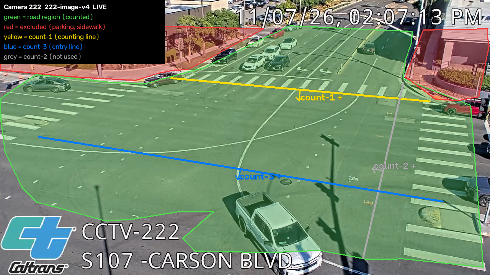
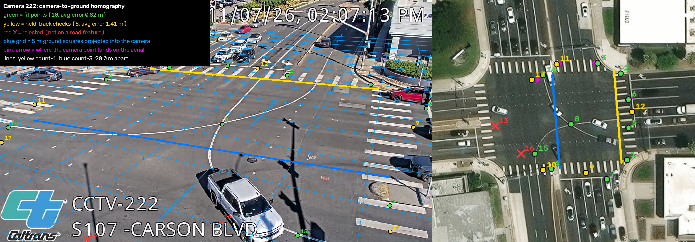

# Emission Lens

**Public intersection cameras → observed traffic → estimated emissions → evidence-backed planning.**

Built by **Mert and Carter** for the **NYCAIRR × HackBU 2026 Environment track**. The demonstration covers four Caltrans intersections in Torrance, California, with counting and completed-movement estimates enabled for cameras **222 and 223**.

Emission Lens tracks vehicles independently at each camera, counts line crossings and estimates tailpipe **CO₂ and NOₓ** from completed movements using documented CARB EMFAC factors. A single workspace brings together processed video, dated traffic evidence, camera-point emissions maps, hypothetical shorter-stop comparisons and downloadable investigation reports.

Outputs are **estimated emissions**. They do not measure air quality, pollutant concentrations or health effects.

## What you can inspect

- **Traffic evidence:** processed frames, line crossings, completed traversals and provisional visible-queue lower bounds, with freshness and coverage shown separately.
- **Traceable estimates:** supported-minute CO₂/NOₓ, calibration and fleet assumptions, factor provenance and unavailable values that remain unavailable.
- **Planning tools:** explicit same-cohort scenarios, durable evidence-review annotations and a two-page visual PDF bound to its reviewed source text and aggregate snapshot.
- **Separate context:** timestamped weather and regional CAMS model data, kept distinct from camera-derived emissions.

## Camera geometry and calibration



*Static camera-222 reference supplied by Carter: green road region, red excluded areas, yellow count-1 and blue count-3 entry line. The grey count-2 line is unused. The image's baked-in LIVE label describes the source illustration; this README is not a live camera view.*

<details>
<summary>View the camera-to-ground calibration reference</summary>



*Carter's reference shows fit/check correspondences, a projected 5 m grid and a configured 20 m separation between the movement lines. These are documented calibration inputs, not independent surveyed validation. See the [image provenance and limitations](./docs/media/carter-2026-11-08/README.md).*

</details>

## Verified checkpoint and limits

The [8 November 2026, 10:30 America/New_York / 15:30 UTC refinement acceptance](./frontend/REFINEMENT.md) records the installed map/report polish, readable units, labeled rich synthetic demonstration and actual PDF/browser checks. The [earlier 10:08 New York / 15:08 UTC acceptance](./frontend/HOME-STRETCH-ACCEPTANCE.md) retains the detailed pipeline and performance evidence. The tested application topology uses a consumer on **3152**, a preview gateway on **3151** and one authoritative writer on **3155**, sharing protected single-host persistence. These are local services, not a public hosted deployment; their availability depends on the running processes and bounded GPU allocation.

| Camera | Location | Counting and estimate scope |
|---|---|---|
| 222 | SR-107 at Carson Boulevard | Owner-enabled count-1; configured 20 m completed movement. [Human-reference count audit](./evaluation/calibration/222-count-audit.md). |
| 223 | SR-107 at Torrance Boulevard | Owner-enabled count-1 based on assisted review; configured 15 m completed movement. Human-reference accuracy remains unavailable. |
| 228 | SR-107 at 182nd Street | Excluded from counting/estimates after failed assisted count screens. Reserved fresh footage remains protected. |
| 220 | SR-1 at Crenshaw Boulevard | Excluded from counting/estimates after failed assisted count screens. |

The deployed baseline remains pretrained YOLO11n/640; the fine-tuned candidate was not promoted. Independent physical/traversal validation, broader human-reference evaluation, sustained outage recovery and shared hosting remain open. Processing FPS and delivered-video FPS are different measurements. The map is a camera-point visualization, not a dispersion model, and scenario changes are hypothetical rather than demonstrated savings.

## Run a local preview

Use **Node.js 24** (matching CI), npm and the checked-in lockfile. From the repository root:

```bash
npm ci
npm run dev -w @emission-lens/frontend -- --port 3000
```

Open [the labeled synthetic workspace](http://localhost:3000/?mode=synthetic&camera=222). Synthetic records are demonstration data and never enter live or replay totals. An unconfigured local preview does not start a GPU worker or supply live observations.

For the optional richer synthetic example, set `EMISSION_LENS_SYNTHETIC_DEMO=rich` in the web consumer environment before starting it. See [demo scope and isolation](./backend/SYNTHETIC-DEMO.md); its fictional movement assumptions never approve real cameras.

For real ingestion, use the private server settings described in [.env.example](./.env.example), [backend setup](./backend/INGESTION.md) and [worker setup](./worker/README.md). Keep tokens, approval registries, stores, outboxes, model weights and raw recordings outside Git. The current file-store architecture needs a persistent host; local setup does not provision hosted persistence.

Useful checks:

```bash
npm test
npm run typecheck
npm run test:emissions
```

A production frontend build uses `npm run build`; Python dependencies and worker checks are documented in the [worker package](./worker/README.md).

## Project guide

| Start here | Purpose |
|---|---|
| [Master plan](./Plan.md) · [coordination](./Coordination.md) · [repository rules](./Agents.md) | Scope, ownership and publication rules. |
| [Frontend](./frontend/README.md) · [backend](./backend/README.md) · [contracts](./contracts/README.md) | Workspace, ingestion, persistence and data meanings. |
| [Worker](./worker/README.md) · [emissions](./emissions/README.md) | Independent tracking, calibrated movements and reproducible RUNEX calculations. |
| [Evaluation index](./evaluation/README.md) · [latest application acceptance](./frontend/HOME-STRETCH-ACCEPTANCE.md) | Run receipts, validation boundaries and measured test scope. |
| [Release package](./release/README.md) · [identity assets](./branding/README.md) | Submission preparation, source availability and attribution. |
| [Worklog](./Worklog.md) · [previous README checkpoints](./docs/README-HISTORY.md) | Dated project history. |

## Scientific and privacy boundaries

`null` means unavailable; zero requires supporting evidence. Live, replay and synthetic modes remain separate, and retained frames do not establish current live processing. Video reports **stopped time**, not whether an engine is running. EMFAC running-exhaust factors already include ordinary driving-cycle idling, so no extra ordinary-idle process is added. Missing completed traversals never silently become zero emissions.

Vehicle identities are temporary and camera-session scoped. There is no plate recognition, facial identification or person tracking. Raw footage is excluded from the public repository. External briefs are drafts and exports; the application does not send messages or contact agencies automatically.

## Licence and sources

Covered project code is **AGPL-3.0-only**: see [LICENSE](./LICENSE), [NOTICE](./NOTICE), [source availability](./release/SOURCE-AVAILABILITY.md) and [third-party notices](./release/THIRD-PARTY-NOTICES.md). Camera imagery/metadata comes from Caltrans/CWWP; factors come from CARB EMFAC. The [release inventory](./release/README.md) records remaining model, media and dependency obligations separately.

**Documentation update — 8 November 2026, 10:32 America/New_York / 8 November 2026, 15:32 UTC — Mert:** Reorganized the project entry points, reconciled dated status summaries and added Carter's two annotated camera-222 references. Earlier README checkpoints are preserved in the linked archive. No contract, camera approval or runtime configuration changed.
