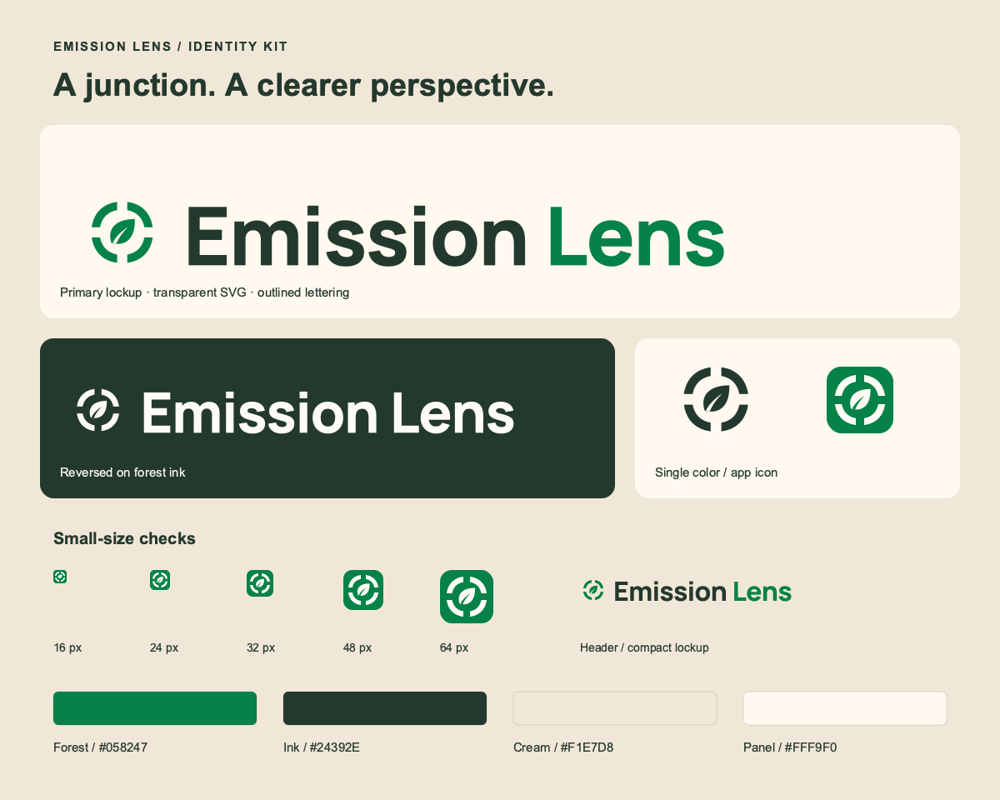

# Emission Lens identity kit

**Owner:** Mert

**Updated:** 7 November 2026, 21:03 America/New_York / 8 November 2026, 02:03 UTC

## Direction

**Junction Lens** combines four slim curved intersection corners with a central leaf. The open horizontal and vertical spaces suggest crossing roads, while the circular outline suggests a lens. The leaf supplies the environmental cue in the same forest green as the primary mark. It is an identity mark, not a camera-health indicator, pollution plume, measured air-quality symbol or accuracy badge.

The kit keeps the approved cream/forest palette and the application's bold Manrope typography. It introduces no new marketing claims or commercial positioning. Mert and Carter remain the team names.



## Ready-to-use assets

Assets are in [`frontend/public/brand/`](../frontend/public/brand/). Mert reviewed the direction and integrated the compact navigation mark and favicon/touch-icon metadata, preserving the existing layout and palette. Production serving and desktop/phone presentation are checked by the dashboard stream.

| Asset | Use |
|---|---|
| `mark.svg` | Forest mark on cream, warm white or other light backgrounds. |
| `mark-cream.svg` | Cream mark on dark backgrounds. |
| `mark-mono.svg` | Ink mark for single-color reproduction. Recolor the single fill only when needed. |
| `wordmark.svg` | Primary horizontal lockup: forest mark, ink “Emission”, forest “Lens”. |
| `wordmark-cream.svg` | All-cream horizontal lockup for forest/ink backgrounds. |
| `wordmark-mono.svg` | All-ink horizontal lockup for one-color reproduction. |
| `favicon.svg` | Cream mark on a forest rounded square. |
| `favicon.ico` | Multi-size 16/32 px browser fallback. |
| `icon-16.png`, `icon-32.png` | Raster favicon sizes. |
| `icon-180.png`, `icon-192.png`, `icon-512.png` | Touch/app/submission icon sizes. |

The production SVG wordmarks use outlined glyphs. They need no web-font request, external image, embedded raster or script to render. The lettering is derived from the repository's bundled Manrope at weight 800; its existing [OFL licence](../frontend/src/app/fonts/Manrope-OFL.txt) remains applicable. The kit does not introduce a project-wide licence decision or trademark clearance claim.

## Tokens and use

| Token | Value | Purpose |
|---|---|---|
| Forest | `#058247` | Primary mark and accent word. |
| Ink | `#24392E` | Primary text and single-color mark. |
| Cream | `#F1E7D8` | Main canvas. |
| Panel | `#FFF9F0` | Warm light surface. |
| Reversed | `#FFFCF6` | Mark/lettering on dark surfaces. |
| Wordmark | Manrope ExtraBold, 800 | Outlined in the supplied assets. |
| Interface | Existing Manrope family and weights | Preserve the current product typography. |

Keep at least **8 units** of clear space around the mark on its **64-unit grid**; the SVG includes that padding. The surrounding bars have a nominal **7-unit** thickness, reduced from the original 12 units. Preserve its aspect ratio. Use the standalone mark at **24 px or larger**, the badge favicon at **16 px or larger**, and the horizontal lockup at **168 px or wider**. For a narrow sidebar, the mark with the existing text lockup is preferable to compressing the full SVG. Do not add shadows, bevels, gradients, a status dot or a bounding ring. Keep the leaf and bars the same color within each treatment: forest on light surfaces, cream when reversed, and ink for monochrome. Do not animate the identity as a live-health signal. Keep scientific labels and data-status colors independent of the brand mark.

The lockup is the primary title treatment. Use the compact mark for navigation/favicon contexts; use the primary lockup for a title slide or submission cover. No new tagline is required. The existing phrase “A clearer perspective.” is compatible, but it is not baked into the logo.

## Verification and reproduction

`preview.svg` and `preview.png` show the primary/reversed/monochrome marks, compact wordmark and 16/24/32/48/64 px badge checks. The SVG assets were parsed and rendered locally, and the PNG icon sizes and alpha channels were checked. Production logos have no live text or external resources. The preview sheet uses system sans-serif for its explanatory labels; those labels are not part of the logo.

Optional authoring tools are isolated outside the repository. From the repository root:

```bash
python3.12 -m pip install --target /tmp/emission-lens-brand-tools \
  fonttools==4.60.2 cairosvg==2.8.2
PYTHONPATH=/tmp/emission-lens-brand-tools \
DYLD_FALLBACK_LIBRARY_PATH=/opt/homebrew/lib \
python3.12 branding/build_assets.py
```

The system Cairo library is required only for regeneration of PNGs. The checked-in SVGs and PNGs need none of these authoring tools at runtime. The builder reads the existing bundled font and writes only this review kit and the new public brand directory. `tokens.json` records the selected values and current compact-mark/favicon activation status.

**Integration note (7 November 2026, 20:58 America/New_York / 8 November 2026, 01:58 UTC):** The compact application mark and favicon are activated. The full wordmarks and larger icons are available for future demo/submission materials. Branding does not alter scientific settings, camera approval, datasets or runtime measurements.

**Leaf revision (7 November 2026, 21:03 America/New_York / 8 November 2026, 02:03 UTC):** At Mert's request, the central diamond is replaced with a leaf and the curved bars are reduced from 12 to 7 nominal grid units. The primary leaf is forest green; reversed and monochrome treatments retain cream/ink equivalents for contrast. All filenames, canvases, wordmark glyphs, spacing, palette and existing interface integration are preserved. Regenerated and visually checked the complete SVG/PNG/ICO kit and 16–64 px preview.

**Optical refinement (8 November 2026, 03:25 America/New_York / 8 November 2026, 08:25 UTC):** Mert softened the four existing corner joins, balanced the central leaf and refined its negative-space vein for a cleaner 16–64 px silhouette. Nominal bars are now 6.5 grid units; palette, asset paths, outlined lettering and the recognizable junction/leaf identity remain. The compact lockup is labeled for the new header. All seven vectors parse, have no external resources/live text, and all five alpha PNG sizes/ICO render correctly. The full review sheet and small sizes were visually inspected. This is a presentation refinement, not a scientific or model-status mark.
