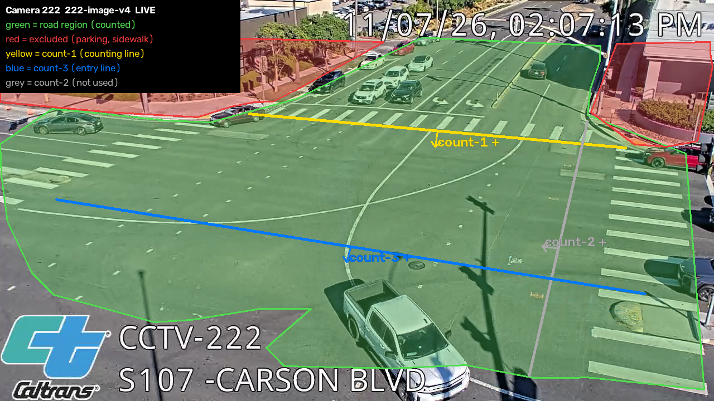
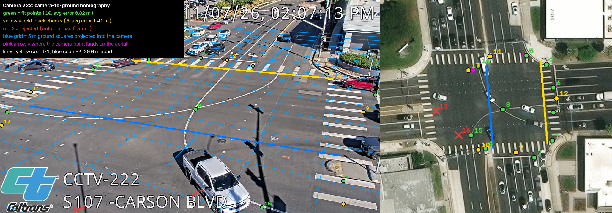

# Camera-222 reference images

**Owner:** Carter, image annotations; Mert, repository publication

**Added:** 8 November 2026, 10:32 America/New_York / 8 November 2026, 15:32 UTC

Carter supplied these two PNGs in the **Images** email sent on **8 November 2026, 09:59:30 America/New_York / 14:59:30 UTC**. Mert requested their publication with the project documentation. The files are the original attachment bytes; no crop, retouching, recompression or metadata changes were applied. Private email headers, addresses, attachment tokens and download links are not published.

## Road region and crossing lines

`camera-222.png` shows the `222-image-v4` reference: green counted road region, red parking/sidewalk exclusions, yellow count-1, blue count-3 entry and grey unused count-2. Positive arrows describe line orientation. Count line crossings, never detections per frame. The baked-in LIVE label and source timestamp are part of a **static reference**, not current processing evidence.

## Camera-to-ground reference

`homography-222.png` shows ten fit points, five held-back checks, rejected correspondences, a projected 5 m ground grid and the configured 20 m entry-to-count separation. The figure reports errors of 0.82 m and 1.41 m; it does not independently establish surveyed scale, curved-path eligibility, speed accuracy or emissions accuracy. Retain the [calibration-readiness limits](../../../evaluation/measurement-readiness.md) and [camera-222 handoff scope](../../../backend/222-HANDOFF.md). No approval is granted by publishing an illustration.

## Provenance and attribution

The camera imagery retains its visible **Caltrans CCTV-222 / S107–Carson Boulevard** attribution. Annotations were supplied by Carter. The email does not identify the aerial-image provider or a separate media licence; no additional licence or endorsement is asserted. The project-code AGPL grant does not establish ownership of third-party imagery. See the [release source inventory](../../../release/README.md) for media attribution boundaries.

| File | Dimensions | Bytes | SHA-256 |
|---|---|---|---|
| `camera-222.png` | 1280 × 720 | 1,237,988 | `7b8658918d7a7189dcb2844b0d1a846998eed050ad356c170ebee87dc7f1a24b` |
| `homography-222.png` | 2060 × 720 | 2,185,310 | `448b9f7b311a08eeadc5cf152c5a1b4bac308db807f9b0018d8ea3edd78eb71e` |

**Publication note — 8 November 2026, 10:32 America/New_York / 8 November 2026, 15:32 UTC — Mert:** Downloaded, decoded and visually inspected both original PNG attachments. These annotated documentation stills are the requested publication scope; raw recordings and private runtime evidence remain excluded.
